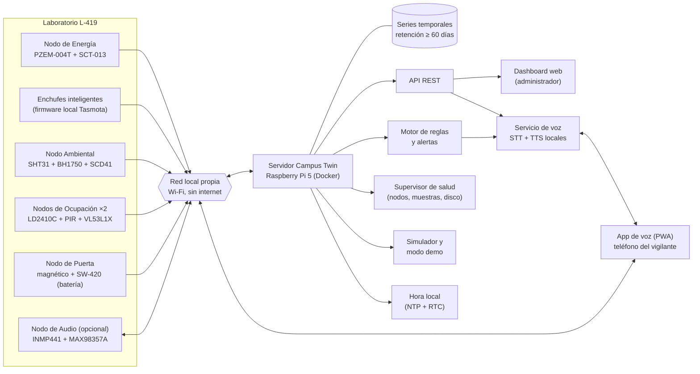

# Idea principal — Campus Twin L-419

> Documento maestro del proyecto: consolida y completa
> [01-preformulacion.md](01-preformulacion.md) e [02-instrumentacion-l419.md](02-instrumentacion-l419.md).
> Los identificadores de requisito (NS, RF, RNF, CP) son los mismos en este documento, en el
> modelo SysML de [modelo/](../modelo/) y en las tareas de Asana.
> Última actualización: **10/09/2026** (semana 5 del ciclo), revisión técnica v2. Los cambios
> frente a la v1 del 03/09 están en la [sección 14.1](#141-revisión-técnica-del-10092026).

## 1. Resumen ejecutivo

Campus Twin es el **gemelo digital de un espacio de enseñanza de UTEC**: el aula laboratorio
**L-419**. Seis nodos ESP32 miden energía, ambiente, ocupación y eventos de puerta, y envían
los datos por Wi-Fi a una Raspberry Pi 5 que actúa de servidor. Sobre esos datos corren dos
interfaces humano-computador: un **dashboard web** para el administrador de infraestructura y
un **copiloto de voz** para el vigilante nocturno, que corre como aplicación web en un
teléfono conectado a la red local, le da un briefing al iniciar su ronda y responde consultas
habladas en español.

El diferenciador del proyecto no es medir: es **cruzar las mediciones**. Con energía,
iluminancia y ocupación en la misma serie temporal, el sistema puede responder algo que hoy
nadie en el campus puede responder con evidencia: *cuánta energía se gasta en un laboratorio
vacío*. Ese es el reporte de **consumo fantasma** (RF-10), y es la base del caso de ahorro.

Todo el sistema funciona **sin internet y sin ninguna nube**: broker, base de datos,
reconocimiento y síntesis de voz, hora y enchufes inteligentes viven en la red local del
proyecto (RNF-05). Eso hace que la demo no dependa de la red del campus ni de terceros.

## 2. Necesidad, problema, causas y solución

| | |
|---|---|
| **Necesidad.** La universidad necesita operar sus espacios de enseñanza con evidencia: saber cuánta energía consumen, en qué condiciones ambientales se dictan las clases y qué pasa en ellos cuando están cerrados. | **Problema.** Hoy el laboratorio L-419 es una caja negra: el consumo solo se conoce agregado en la factura del edificio, el confort se reporta por queja y la vigilancia nocturna depende de lo que el vigilante alcanza a ver en su ronda. |
| **Causas.** (1) No hay instrumentación por espacio, solo medición general del edificio. (2) Instalar medición suele exigir intervenir el tablero eléctrico, lo que requiere permisos y paradas. (3) La información existente no llega a quien decide en el momento en que decide: el vigilante no tiene pantalla y el administrador no tiene datos por ambiente. | **Solución.** Un gemelo digital del laboratorio con instrumentación no invasiva, servidor local y dos interfaces: dashboard web para análisis y copiloto de voz para operación en campo. El propio laboratorio es el banco de pruebas y la evidencia. |

## 3. Stakeholders

| Stakeholder | Qué le importa | Qué obtiene del sistema | Cómo participa |
|---|---|---|---|
| **Vigilante nocturno** | Hacer la ronda rápido, sin cargar equipo, y no perderse un incidente | Briefing de turno por voz y consultas orales desde un teléfono (RF-09), alertas de puerta (RF-04, RF-08) | Entrevista de necesidades (S5) y prueba de uso del copiloto (S12). La vigilancia es tercerizada: la entrevista y la prueba requieren autorización de Seguridad del campus y del contratista |
| **Administrador de infraestructura / Servicios Generales** | Reducir consumo y sustentarlo con datos (LEED/EDGE) | Dashboard con consumo, históricos y reporte de consumo fantasma (RF-01, RF-06, RF-07, RF-10, RF-12) | Autoriza la instalación, supervisa la colocación de la pinza en el tablero y valida el reporte de ahorro |
| **Coordinador del laboratorio / docentes** | Que el ambiente sea apto para clase y equipos | CO₂, temperatura, humedad e iluminancia en vivo (RF-02) y alertas de confort (RF-08) | Define horarios de acceso e interpreta umbrales |
| **Seguridad del campus** | Detectar accesos y manipulaciones fuera de horario | Eventos de puerta y vibración con alerta (RF-04) | Define el horario, el protocolo de alerta y autoriza la participación del vigilante |
| **Estudiantes del laboratorio** | Privacidad | Sin cámaras ni audio almacenado; ocupación agregada (RNF-02) | Restricción de diseño, no negociable |
| **Equipo PI3 y docente del curso** | Demo en vivo y entregables a tiempo | Modo demostración (RF-11) y sistema estable 72 h (RNF-06) | Ejecuta el proyecto; el docente evalúa |
| **Red / TI de UTEC** | No abrir huecos en la red del campus | Red local propia, aislada y con credenciales (RNF-05, RNF-08) | Autoriza o no el uso de la red institucional y el router propio |

## 4. Alcance: el laboratorio L-419 como piloto

El piloto es un **laboratorio**, no un aula común, y eso cambia tres cosas a favor:

| Condición del laboratorio | Qué habilita |
|---|---|
| **Acceso a energía** (tomacorrientes disponibles en varios puntos) | Los nodos fijos van alimentados con fuente de 5 V, sin depender de batería: se puede medir de forma continua, de noche y por días seguidos (RNF-06). La batería queda solo para el nodo de puerta (RNF-04). |
| **Wi-Fi disponible** | Los nodos transmiten sin cablear datos. Si TI no autoriza los dispositivos en la red institucional, se levanta un router propio y el sistema sigue funcionando igual (RNF-05). |
| **Espacio amplio** | Se cubre la sala con **dos nodos de ocupación** (uno en la puerta con el contador ToF, otro al fondo), separados del sensor de puerta y sin solaparse; también hay sitio para el banco de pruebas y para instalar sin estorbar la clase. |
| **Equipos propios del laboratorio** (PCs, proyector, instrumentos) | Hay cargas medibles e identificables por enchufe inteligente, que es lo que hace interesante el reporte de consumo fantasma. |

**Dentro del alcance:** un espacio (L-419); cuatro tipos de nodo de sensado en **seis nodos
físicos** (energía, ambiental, ocupación ×2, puerta, más el nodo de audio opcional); servidor
local; dashboard web en LAN; copiloto de voz en español desde un teléfono en la red local;
reporte de consumo fantasma y ahorro estimado; simulador y modo demostración.

**Fuera del alcance (declarado):** control de actuadores (el sistema informa, no apaga cargas);
gemelo 3D fotorrealista (se usa un plano 2D del laboratorio); escalamiento a todo el campus
(se documenta cómo replicar, no se replica); reconocimiento de personas o cámaras;
reconocimiento de hablante o palabra de activación ("wake word"): el copiloto se activa con un
botón; acceso al sistema desde fuera de la red local; roles múltiples en el dashboard (hay un
solo usuario administrador).

## 5. ODS

| ODS | Cómo lo aborda el proyecto |
|---|---|
| **7 — Energía asequible y no contaminante** | Mide y reduce consumo evitable; el reporte de consumo fantasma cuantifica el desperdicio. |
| **11 — Ciudades y comunidades sostenibles** | Instrumenta infraestructura educativa existente sin obra civil, con un método replicable a otros ambientes. |
| **13 — Acción por el clima** | Traduce kWh evitados a emisiones evitadas con el factor de emisión de la red peruana (SEIN), configurable. |
| **4 — Educación de calidad** (secundario) | Condiciones ambientales aptas para el dictado y un laboratorio que sirve de caso de estudio. |
| **9 — Innovación e infraestructura** (secundario) | Gemelo digital de bajo costo con hardware abierto, documentado para reproducirse. |

## 6. Arquitectura de la solución

**Cadena de datos:** sensores → ESP32 → Wi-Fi → Raspberry Pi 5 (broker + base de datos) →
LAN → dashboard web y app de voz. Ningún sensor lleva cable de datos hasta la computadora y
la instalación no perfora paredes ni corta conductores (RNF-01).

| Subsistema | Responsabilidad | Bloque en el modelo SysML |
|---|---|---|
| Subsistema de Sensado | Adquirir y publicar mediciones | `Nodo Sensor ESP32` y sus especializaciones |
| Servidor Campus Twin | Recibir, almacenar, servir, evaluar reglas, supervisar nodos, simular y dar la hora | `Servidor Campus Twin` (broker MQTT, base de series temporales, API REST, motor de reglas, servicio de voz, supervisor de salud, simulador y modo demo, servidor NTP local) |
| Dashboard Web | Visualización, reportes y panel de salud | `Dashboard Web` |
| Copiloto de Voz | Briefing y consultas orales | `Copiloto de Voz` (app de voz PWA en el teléfono; nodo de audio fijo como extensión) |
| Red Local | Transporte, aislada de la red del campus si hace falta, con credenciales | `Red Local` |
| Subsistema de Alimentación | Energía de nodos y servidor | `Subsistema de Alimentación` |

### 6.1 Decisiones técnicas

Fijadas para que el contrato de datos (S6) y el firmware (S7) no las vuelvan a discutir.

| Decisión | Elección | Por qué |
|---|---|---|
| Transporte | MQTT sobre Wi-Fi 2.4 GHz, QoS 1, un tópico por nodo y magnitud (`l419/<nodo>/<magnitud>`) | Simple, con reintento incorporado y soportado por ESP32 y Tasmota |
| BLE | Solo para configuración del radar LD2410C desde el celular; no se usa para transporte de datos | Evita dos rutas de datos y sus casos borde |
| Broker y base de datos | Mosquitto + InfluxDB 2 con retención por bucket | Retención de 60 días nativa (RF-06), consultas por rango y agregación |
| Servidor | Todos los servicios en Docker Compose (arm64 y x86) | El mismo `compose` corre en la laptop desde S5 y en la Pi 5 cuando llegue; mitiga el retraso de compras |
| API y reglas | Python (FastAPI); reglas en un archivo de configuración YAML | Configurabilidad (RNF-07) y una sola base de código para API, reglas y voz |
| Dashboard | Aplicación web servida por el propio servidor, accesible en LAN por HTTPS | Sin dependencias externas; el mismo certificado sirve a la app de voz |
| Voz | STT con faster-whisper (modelo `small`, int8, español) y TTS con Piper (voz `es_ES`), ambos en la Pi 5 | Sin nube (RNF-05, RNF-02); latencia ≤ 5 s con frases cortas |
| App de voz | PWA en el navegador del teléfono, activación por botón ("pulsar para hablar"), servida por HTTPS con certificado propio instalado en el teléfono | El navegador bloquea el micrófono sobre HTTP; sin app nativa que instalar |
| Enchufes inteligentes | Modelos compatibles con Tasmota o ESPHome, publicando por MQTT al broker local | Los enchufes de nube no funcionan sin internet (RNF-05) |
| Firmware ESP32 | PlatformIO (framework Arduino), configuración en `config.h` generado desde `config.example.h` | Sin credenciales en el repo (RNF-07) |
| Hora | La Pi 5 es servidor NTP de la red local y tiene batería de RTC; los nodos sincronizan al arrancar y cada hora | No hay internet para NTP; sin hora correcta el consumo fantasma y "fuera de horario" no tienen sentido |
| Marca de tiempo | El nodo envía su marca de tiempo; el servidor la reemplaza por la propia si la diferencia supera 5 min o el nodo no está sincronizado | Cubre reinicios del nodo con hora inválida |
| Idempotencia | Cada muestra lleva `nodo + secuencia`; el servidor descarta duplicados | El buffer local reenvía muestras al reconectar (RF-05) |

## 7. Casos de uso principales

1. **Briefing de ronda (vigilante, 22:00).** Abre la app de voz en el teléfono, pulsa
   "briefing" y el copiloto responde: estado de puerta, ocupación, consumo actual y si hay
   algo anómalo desde el turno anterior. → RF-09, RF-08.
2. **Consulta durante la ronda (vigilante, 01:30).** Frente al L-419 pulsa el botón y pregunta
   *"¿hay alguien adentro?"*; el copiloto responde en menos de 5 s. Si no entiende, lo dice y
   pide repetir. → RF-09.
3. **Consumo fantasma (administrador, cierre de mes).** El dashboard reporta cuántos kWh se
   consumieron con el laboratorio desocupado, desglosados por franja horaria y por carga, y
   estima el ahorro de corregirlo. → RF-10, RF-07, RF-01, RF-12, RF-03.
4. **Confort en clase (coordinador, media mañana).** El CO₂ pasa el umbral con el laboratorio
   lleno; el dashboard alerta y queda registrado para justificar ventilación. → RF-02, RF-08.
5. **Apertura fuera de horario (seguridad, 03:00).** El sensor magnético detecta apertura sin
   ocupación programada: se registra el evento y el copiloto lo anuncia en la siguiente
   consulta del vigilante. → RF-04, RF-08.
6. **Nodo caído (equipo, cualquier día).** El nodo ambiental deja de reportar; en 5 min el
   dashboard lo marca en rojo y el motor de reglas genera una alerta de salud. → RF-13, RF-08.
7. **Demo con hardware parcial (equipo, 13/11).** Un nodo falla el día de la presentación; el
   operador activa la reproducción de datos grabados solo para ese nodo y el dashboard lo
   etiqueta como DEMO. → RF-11.

## 8. Requisitos

### 8.1 Necesidades de stakeholder (NS)

| ID | Necesidad | Enunciado |
|---|---|---|
| NS-1 | Ronda informada | El vigilante nocturno necesita conocer el estado del laboratorio durante su ronda sin cargar una laptop. |
| NS-2 | Consumo bajo control | El administrador de infraestructura necesita evidencia medible del consumo para reducirlo y sustentar certificaciones. |
| NS-3 | Ambiente apto | El coordinador del laboratorio necesita temperatura, humedad y CO₂ aptos para las clases y los equipos. |
| NS-4 | Acceso vigilado | Seguridad del campus necesita detectar aperturas o manipulaciones del laboratorio fuera de horario. |
| NS-5 | Demostración reproducible | El equipo de PI3 necesita una demo en vivo que funcione sin depender de la red del campus. |
| NS-6 | Red segura | TI de UTEC necesita que los dispositivos del proyecto no abran huecos ni interfieran en la red del campus. |
| NS-7 | Privacidad | Los estudiantes y el personal del laboratorio necesitan que el sistema no los identifique ni grabe. |

### 8.2 Requisitos funcionales (RF)

| ID | Requisito | Criterio de aceptación | Deriva de | Bloque que lo satisface | Se verifica con |
|---|---|---|---|---|---|
| RF-01 | Medición de energía total | Tensión, corriente, potencia activa, factor de potencia y energía acumulada del alimentador del laboratorio con PZEM-004T (toma de tensión en un tomacorriente, pinza en el alimentador), periodo ≤ 10 s y error ≤ ±2 % frente a instrumento patrón. **Condicionado al permiso de abrir la tapa del tablero**; si no se otorga, RF-01 se cumple en modo degradado como suma de las cargas de RF-12 con error ≤ ±5 % y se documenta en el informe | NS-2 | Nodo de Energía | CP-01 |
| RF-02 | Medición ambiental | Temperatura (±0.5 °C), humedad (±3 % HR), CO₂ (±50 ppm + 5 % de la lectura) e iluminancia (±20 %) con periodo ≤ 60 s. Exactitudes según hoja de datos, verificadas por consistencia | NS-3 | Nodo Ambiental | CP-07 |
| RF-03 | Estimación de ocupación | **Presencia** binaria sin cámaras con acierto ≥ 95 % (incluidas personas quietas) y latencia ≤ 30 s. **Conteo** estimado en la puerta con dos zonas ToF, error ≤ ±2 con hasta 10 personas entrando de a una; el conteo se reinicia a 0 cuando la presencia es "vacío" por ≥ 5 min y nunca baja de 0. El consumo fantasma usa solo la presencia | NS-1, NS-3 | Nodo de Ocupación | CP-02 |
| RF-04 | Eventos de puerta | Apertura, cierre y vibración registrados en ≤ 10 s; latido cada 30 min con nivel de batería; una apertura prolongada genera un solo evento de apertura y uno de cierre | NS-4 | Nodo de Puerta | CP-08 |
| RF-05 | Transporte de datos | Envío por Wi-Fi con MQTT QoS 1, reconexión con espera exponencial (1 s a 60 s), buffer local en el nodo ≥ 15 min (≥ 90 muestras a 10 s) ante caída del servidor o del router, reenvío en orden al reconectar y descarte de duplicados en el servidor | NS-5 | Red Local | CP-03 |
| RF-06 | Histórico y consulta | Capacidad de retención ≥ 60 días en la microSD; al cierre del ciclo ≥ 4 semanas continuas de datos reales; API de consulta por rango, magnitud y agregación (crudo, 1 min, 1 h, 1 día) | NS-2 | Base de Datos de Series Temporales | CP-09 |
| RF-07 | Dashboard web | Estado en vivo con refresco ≤ 5 s, históricos, plano 2D del laboratorio, reporte de ahorro y panel de salud, accesible en la LAN sin internet | NS-2 | Dashboard Web | CP-09 |
| RF-08 | Alertas por reglas | Reglas configurables en archivo: consumo con laboratorio vacío, CO₂ alto, puerta fuera de horario, nodo sin reportar y batería baja. Notificadas en dashboard y voz, con silencio configurable para no repetir la misma alerta más de una vez cada 15 min | NS-1, NS-4 | Motor de Reglas y Alertas | CP-10 |
| RF-09 | Copiloto de voz | App web en el teléfono del vigilante con activación por botón: briefing de turno y respuesta a consultas orales en español en ≤ 5 s desde el fin del habla, con al menos 8 intenciones cerradas (estado general, puerta, ocupación, consumo, temperatura, CO₂, alertas pendientes, última apertura) y respuesta de "no entendí, repite" cuando la confianza es baja | NS-1 | Copiloto de Voz | CP-04 |
| RF-10 | Detección de consumo fantasma | Reporte de energía consumida con el laboratorio desocupado (presencia "vacío" ≥ 15 min consecutivos) dentro y fuera del horario oficial, desglosado por franja horaria y por carga, con ahorro estimado en S/ y kg CO₂ usando tarifa y factor de emisión configurables | NS-2 | Motor de Reglas y Alertas | CP-06 |
| RF-11 | Modo demostración y simulador | Generación de datos sintéticos desde S5 para desarrollar sin hardware y reproducción de un día de datos grabados, activable por nodo o para todo el sistema, con etiqueta DEMO visible en dashboard y voz | NS-5 | Simulador y Modo Demo | CP-11 |
| RF-12 | Medición de energía por carga | Enchufes inteligentes con firmware local (Tasmota/ESPHome) en proyector y PC principal, publicando potencia y energía por MQTT al broker local, periodo ≤ 60 s y error ≤ ±5 %, sin dependencia de internet | NS-2 | Nodo de Energía | CP-01 |
| RF-13 | Supervisión de salud del sistema | Por nodo: última muestra, intensidad de señal, batería y muestras perdidas; por servidor: espacio en disco y estado de servicios. Un nodo se marca caído tras tres periodos sin reportar, con un mínimo de 5 min (el nodo de puerta late cada 30 min, así que su umbral es 90); muestras perdidas, medidas por huecos de secuencia, ≤ 1 % en una semana | NS-5 | Supervisor de Salud | CP-15 |

### 8.3 Requisitos no funcionales y restricciones (RNF)

| ID | Restricción | Criterio de aceptación | Deriva de | Se verifica con |
|---|---|---|---|---|
| RNF-01 | Instalación no invasiva y segura | Sin perforar paredes ni cortar o desconectar conductores: montaje adhesivo y pinza no invasiva. Abrir la tapa del tablero para abrazar la pinza no es intervención, y lo hace o supervisa Servicios Generales. Las conexiones a 220 V (toma de tensión del PZEM) van en caja cerrada con enchufe y fusible, sin conductores expuestos | NS-5 | CP-12 |
| RNF-02 | Privacidad por diseño | Sin cámaras; el audio se procesa en memoria y se descarta, guardando solo el texto de la intención reconocida y de la respuesta; ocupación reportada de forma agregada; no se registra quién consulta | NS-4, NS-7 | CP-12 |
| RNF-03 | Presupuesto acotado | ≤ S/ 2808 en la versión completa; versión mínima operativa de S/ 580 | NS-5 | CP-14 |
| RNF-04 | Autonomía del nodo de puerta | ESP32-C3 en sueño profundo con despertar por interrupción del magnético y del SW-420, latido cada 30 min; ≥ 30 días con una LiPo de 2000 mAh; alerta de batería baja al 20 % | NS-4 | CP-13 |
| RNF-05 | Operación autónoma sin internet | Todo el sistema (nodos, enchufes, servidor, dashboard, voz y hora) opera sobre router propio sin conexión a internet; ningún componente depende de una nube | NS-5, NS-6 | CP-03 |
| RNF-06 | Disponibilidad para la demo | 72 h continuas sin intervención manual antes de la presentación; servicios y nodos con arranque automático y watchdog; respaldo diario de la base de datos a un disco USB | NS-5 | CP-05 |
| RNF-07 | Configurabilidad | Pines, umbrales, intervalos, horario oficial, tarifa, factor de emisión y endpoints en configuración; sin credenciales en el repositorio | NS-5 | CP-14 |
| RNF-08 | Seguridad básica de acceso | Red propia con WPA2 y clave; broker MQTT con usuario y contraseña; dashboard y API con inicio de sesión; HTTPS con certificado propio; sin puertos expuestos hacia la red del campus | NS-6 | CP-14 |

### 8.4 Casos de prueba (CP)

| ID | Ensayo | Verifica |
|---|---|---|
| CP-01 | Exactitud de energía contra multímetro y carga conocida (PZEM y enchufes); ensayo del modo degradado por suma de cargas | RF-01, RF-12 |
| CP-02 | Ocupación: presencia con personas quietas (20 min, con y sin ventilador encendido) y conteo en la puerta con 10 entradas y salidas | RF-03 |
| CP-03 | Resiliencia de red y sin internet: 15 min sin servidor, caída del router, reconexión, verificación de que no hay duplicados ni huecos, y todo el sistema (enchufes y voz incluidos) con el router sin salida a internet | RF-05, RNF-05 |
| CP-04 | Copiloto de voz: 20 consultas por 2 hablantes en la app del teléfono, con ruido de pasillo; latencia y aciertos | RF-09 |
| CP-05 | Maratón de 72 horas sin intervención, con un corte de energía provocado | RNF-06 |
| CP-06 | Auditoría de consumo fantasma en una semana de datos, contrastada con el horario oficial | RF-10 |
| CP-07 | Verificación de consistencia ambiental: SHT31 contra termohigrómetro de referencia; SCD41 con calibración forzada al aire exterior (≈ 420 ppm) y coherencia con la ocupación; BH1750 contra luces encendidas/apagadas | RF-02 |
| CP-08 | Eventos de puerta: apertura, apertura prolongada, golpe y falso positivo por vibración del pasillo | RF-04 |
| CP-09 | Histórico, API y dashboard: consultas por rango y agregación, refresco y panel de salud | RF-06, RF-07 |
| CP-10 | Reglas de alerta: disparo, silencio, umbral configurable y alerta de nodo caído | RF-08 |
| CP-11 | Modo demostración con hardware desconectado, total y por nodo, con etiqueta DEMO | RF-11 |
| CP-12 | Revisión de instalación no invasiva, seguridad eléctrica y privacidad | RNF-01, RNF-02 |
| CP-13 | Autonomía del nodo de puerta: consumo medido en sueño y en evento, proyección a 30 días | RNF-04 |
| CP-14 | Auditoría de costos, de configuración del repositorio y de credenciales | RNF-03, RNF-07, RNF-08 |
| CP-15 | Supervisión: apagar un nodo y verificar marca de caído, alerta y métrica de muestras perdidas | RF-13 |

### 8.5 Casos borde y comportamiento esperado

Cada situación tiene un comportamiento definido y un requisito que lo cubre. Si aparece un caso
nuevo, se agrega aquí antes de programarlo.

| Situación | Comportamiento esperado | Cubierto por |
|---|---|---|
| Se cae el servidor o el router | El nodo guarda en buffer hasta 15 min, reintenta con espera exponencial y reenvía en orden al reconectar | RF-05 |
| El buffer se llena | Se descartan las muestras más antiguas y se registra la cantidad descartada en el siguiente mensaje de salud | RF-05, RF-13 |
| Muestras reenviadas dos veces | El servidor descarta duplicados por `nodo + secuencia` | RF-05 |
| El nodo se reinicia y tiene hora inválida | Sincroniza NTP con la Pi al arrancar; mientras tanto el servidor usa su propia hora de recepción | RF-05, decisión "Hora" |
| Corte de energía del laboratorio | La Pi mantiene la hora con RTC, los servicios arrancan solos, los nodos fijos reinician y reconectan; el nodo de puerta sigue con batería | RNF-06, RNF-04 |
| La microSD se corrompe o se llena | Retención de 60 días acota el tamaño; respaldo diario a USB; imagen de la SD guardada para restaurar en < 1 h | RNF-06 |
| Un nodo deja de reportar | A los 5 min se marca caído en el dashboard y se dispara la alerta de salud | RF-13, RF-08 |
| Batería del nodo de puerta baja | Alerta al 20 % en dashboard y en el briefing del vigilante | RNF-04, RF-08 |
| Radar con falsos positivos (ventilador, aire acondicionado, cortina) | Zona de sensibilidad configurada por BLE, fusión con PIR y validación con CO₂; se prueba con el ventilador encendido | RF-03, CP-02 |
| Varias personas cruzan la puerta a la vez | El conteo se reconoce como estimación (±2); se reinicia a 0 al detectar "vacío" ≥ 5 min | RF-03 |
| Conteo negativo | Se limita a 0 y se registra el evento para calibración | RF-03 |
| Puerta abierta por mucho tiempo | Un evento de apertura y uno de cierre; sin alertas repetidas | RF-04, RF-08 |
| Vibración del pasillo sin apertura | Umbral del SW-420 configurable y evento marcado como "vibración" sin alerta si no hay apertura en 60 s | RF-04, CP-08 |
| No autorizan abrir el tablero | RF-01 en modo degradado por suma de cargas (RF-12), documentado | RF-01, RF-12 |
| TI prohíbe el router propio | Se usa como red local el punto de acceso de un teléfono del equipo durante pruebas y demo | RNF-05, riesgo 2 |
| El teléfono del vigilante sale de la cobertura Wi-Fi | La app muestra "sin conexión" y ofrece reintentar; no hay respuesta silenciosa | RF-09 |
| El navegador bloquea el micrófono | La app se sirve por HTTPS con certificado propio instalado en el teléfono del equipo; se verifica en S6 | RF-09, RNF-08 |
| El copiloto no entiende la consulta | Responde "no entendí, repite" y muestra en pantalla las consultas que sí entiende | RF-09 |
| Ruido de fondo alto | Activación por botón y frases cortas; se ensaya con ruido de pasillo en CP-04 | RF-09, CP-04 |
| Consulta fuera del horario nocturno | El copiloto responde igual; el briefing automático solo se ofrece entre 22:00 y 06:00 | RF-09 |
| Cambio de horario oficial, feriado o semana sin clases | Horario y calendario de excepciones en configuración; "fuera de horario" se evalúa contra ese calendario | RNF-07, RF-08 |
| Un nodo falla el día de la demo | Reproducción de datos grabados solo para ese nodo, con etiqueta DEMO | RF-11 |
| Mezcla de datos reales y de demo | Toda muestra lleva el origen `real` o `demo`; el reporte de consumo fantasma excluye las de demo | RF-11, RF-10 |
| Se pierde la credencial del broker o del dashboard | Credenciales en archivo local fuera del repo, con `.example` versionado; se regeneran sin tocar el código | RNF-07, RNF-08 |
| Un dispositivo ajeno intenta conectarse a la red del proyecto | Red con WPA2 y clave, broker con usuario y contraseña; sin puertos hacia la red del campus | RNF-08 |
| El enchufe inteligente pierde el firmware local | Se reflashea desde el repo; mientras tanto la carga aparece como "sin dato" y no como 0 | RF-12, RF-13 |
| Lectura fuera de rango físico (CO₂ < 400 ppm, humedad > 100 %) | Se marca como inválida, no se grafica y cuenta como muestra perdida | RF-13 |

## 9. Métricas de éxito

| Métrica | Meta al cierre (semana 14) |
|---|---|
| Cobertura de requisitos | 100 % de RF y RNF con bloque que los satisface y caso de prueba ejecutado |
| Exactitud de energía | Error ≤ ±2 % con PZEM y ≤ ±5 % con enchufes, frente a instrumento patrón |
| Presencia | Acierto ≥ 95 % en CP-02; conteo con error ≤ ±2 |
| Disponibilidad | ≥ 72 h continuas sin intervención (RNF-06) |
| Datos perdidos | ≤ 1 % de muestras perdidas en una semana |
| Datos reales acumulados | ≥ 4 semanas continuas al 13/11 |
| Consumo fantasma identificado | ≥ 5 % del consumo semanal del laboratorio cuantificado como evitable |
| Copiloto de voz | ≥ 80 % de respuestas correctas en 20 consultas por 2 hablantes, latencia ≤ 5 s |
| Costo | ≤ S/ 2808 ejecutado |

## 10. Instrumentación y presupuesto

El detalle por ítem (tienda, enlace, SKU, cantidad y precio) está en
[02-instrumentacion-l419.md](02-instrumentacion-l419.md). Resumen de la versión 2 (10/09/2026):

| Módulo | S/ | Nota |
|---|---|---|
| Procesadores | 888 | 5 ESP32 DevKit + ESP32-C3 + Raspberry Pi 5, batería RTC y accesorios |
| Energía | 355 | PZEM-004T + SCT-013 + 2 enchufes compatibles con Tasmota |
| Ambiente | 286 | SCD41, SHT31, BH1750 |
| Ocupación | 266 | LD2410C, PIR, VL53L1X para dos nodos |
| Puerta y seguridad | 36 | Magnético + SW-420 |
| Copiloto de voz | 98 | Nodo de audio opcional; el teléfono lo pone el equipo |
| Integración | 879 | Router, fuentes, cajas, cables, multímetro, termohigrómetro de referencia |
| **Total** | **2808** | Versión mínima: **580** (sin Pi, usando laptop del equipo) |

Como el laboratorio tiene tomacorrientes, la versión completa se instala alimentada de red y
**no** se aplica la limitación de la versión mínima ("no se pueden tomar datos de noche ni
durante días seguidos"): la medición continua es justamente lo que sostiene RF-10 y RNF-06.

## 11. Riesgos y mitigaciones

| # | Riesgo | Impacto | Mitigación |
|---|---|---|---|
| 1 | No autorizan abrir el tablero para la pinza del PZEM-004T | Alto: sin medición total del laboratorio | RF-01 en modo degradado por suma de cargas (RF-12) con ±5 %; se pide el permiso en S5 y se decide antes de comprar |
| 2 | TI no autoriza los ESP32 en la red del campus, o prohíbe el router propio | Alto: sin transporte de datos | Router propio ya presupuestado (RNF-05), con canal fijo y potencia baja; si se prohíbe, punto de acceso de un teléfono del equipo; verificado en CP-03 |
| 3 | Enchufes inteligentes dependientes de nube | Alto: sin medición por carga ni sin internet | Comprar solo modelos compatibles con Tasmota/ESPHome; probar sin internet en el banco de pruebas (S6) antes de instalar |
| 4 | Retraso en compras o stock agotado (Raspberry Pi 5 "por cotizar") | Medio: corre el cronograma | Compra en S6 con proveedor alterno; el servidor se desarrolla en laptop con Docker desde S5 y se migra a la Pi cuando llegue; versión mínima (S/ 580) como plan B |
| 5 | Radar de ocupación con falsos positivos | Medio: ocupación poco creíble | Fusión de radar + PIR + conteo ToF, validación con CO₂ y zonas de sensibilidad; CP-02 se ejecuta con ventilador encendido |
| 6 | Conteo de personas impreciso | Bajo: el conteo es informativo | Presencia binaria como requisito duro; conteo con reinicio a 0 al vaciarse el laboratorio (RF-03) |
| 7 | Latencia o error del copiloto de voz | Medio: la demo pierde efecto | Intenciones cerradas, respuestas plantilladas, STT y TTS locales medidos en el banco desde S6; CP-04 mide latencia y aciertos |
| 8 | El navegador bloquea el micrófono sobre HTTP | Medio: la app de voz no funciona | HTTPS con certificado propio instalado en el teléfono del equipo, probado en S6 |
| 9 | La vigilancia es tercerizada y no se puede entrevistar ni probar con el vigilante | Medio: sin validación con el usuario real | Pedir permiso a Seguridad y al contratista en S5; plan B: guion de vigilante ejecutado por un integrante en CP-04 |
| 10 | Falla de hardware el día de la presentación | Alto: no hay demo | Modo demostración por nodo con datos grabados (RF-11, CP-11) |
| 11 | Pérdida de datos por corte de energía o microSD dañada | Medio | Buffer local en el nodo (RF-05), RTC en la Pi, arranque automático, respaldo diario a USB e imagen de la SD (RNF-06) |
| 12 | Hora incorrecta sin internet | Medio: consumo fantasma y "fuera de horario" mal calculados | Pi como servidor NTP con batería de RTC; los nodos sincronizan al arrancar |
| 13 | Seguridad eléctrica al conectar el PZEM a 220 V | Alto: riesgo para personas y equipos | Caja cerrada con enchufe y fusible, sin conductores expuestos, instalada o supervisada por Servicios Generales (RNF-01, CP-12) |
| 14 | Sobrecarga académica del equipo en semanas 10-13 | Medio | Tareas de una semana como máximo, un responsable por tarea y revisión semanal en Asana; el nodo de audio es opcional y se descarta primero |

## 12. Plan de trabajo (semanas 4 a 14)

Semana 4 = 31/08–06/09/2026. Entrega final: **viernes 13/11/2026** (semana 14). El detalle por
tarea, con casillas de avance, está en [03-plan.md](03-plan.md).

| Semana | Fechas | Foco | Responsable principal |
|---|---|---|---|
| S4 | 31/08–06/09 | Formulación, modelo SysML (req + bdd), proyecto en Asana | Luhana / José |
| S5 | 07/09–13/09 | Entrevistas a stakeholders, permisos de instalación, red y vigilante, cierre de cotización; simulador de datos y servidor en laptop (Docker) | Luhana / José |
| S6 | 14/09–20/09 | Compra y recepción de componentes, banco de pruebas (enchufes sin internet, micrófono por HTTPS, STT/TTS), contrato de datos (tópicos MQTT, esquema, idempotencia) | Carlos / José / Esteban |
| S7 | 21/09–27/09 | Firmware base ESP32 (Wi-Fi, reconexión, buffer, NTP) y servidor en Pi (broker, base de series temporales, NTP, arranque automático) | Carlos / José |
| S8 | 28/09–04/10 | Nodo de energía con enchufes y nodo ambiental integrados y verificados (CP-01, CP-07) | Carlos / Luhana |
| S9 | 05/10–11/10 | Dos nodos de ocupación y nodo de puerta (CP-02, CP-08, CP-13); instalación definitiva | Esteban / Carlos |
| S10 | 12/10–18/10 | API REST, motor de reglas, supervisor de salud y consumo fantasma (CP-09, CP-10, CP-15) | José |
| S11 | 19/10–25/10 | Dashboard web con vivo, históricos, plano 2D, salud y reporte de ahorro | José |
| S12 | 26/10–01/11 | Copiloto de voz: app en el teléfono, briefing y consultas (CP-04); nodo de audio solo si sobra tiempo | Esteban |
| S13 | 02/11–08/11 | Pruebas de sistema: maratón 72 h, consumo fantasma, modo demo, revisiones (CP-03, CP-05, CP-06, CP-11, CP-12, CP-14) | Luhana / todos |
| S14 | 09/11–15/11 | Informe final, póster, ensayo y **presentación (13/11)** | Todos |

Reparto por subsistema:

| Integrante | Responsabilidad |
|---|---|
| **José Eduardo Huamán** | Líder técnico: servidor (Docker), broker, base de datos, API REST, reglas, supervisor de salud, simulador, dashboard web, integración |
| **Carlos Dávila** | Firmware ESP32, nodo de energía y enchufes, red local, hora y alimentación, instalación |
| **Esteban Sotomayor** | Nodos de ocupación, nodo de puerta, app de voz y servicio STT/TTS |
| **Luhana Landeo** | Modelo SysML y documentación, stakeholders y permisos, compras, nodo ambiental, plan y ejecución de pruebas |

## 13. Entregables

1. **Documentación** en `docs/`: idea principal (este documento), pre-formulación, instrumentación costeada y plan.
2. **Modelo SysML** en `modelo/campus-twin-l419.gaphor`: 12 diagramas — 7 de requisitos y 5 de definición de bloques, incluido el paquete `00 Vista general` con el sistema completo y el mapa de requisitos, cada uno en un solo diagrama. Exportados en `modelo/export/`.
3. **Plan en Asana**: fases S4–S14 con tareas, responsables, fechas e hitos.
4. **Firmware** de los nodos ESP32 y configuración de los enchufes, **servidor** (Docker Compose con broker, base de datos, API, reglas, salud, simulador y voz) y **dashboard web**, cada uno con su README.
5. **Copiloto de voz**: app web en el teléfono con briefing y consultas en español.
6. **Simulador y modo demostración** en `demo/`: simulador de los seis nodos, tablero web y el modelo SysML actualizándose en vivo. Ver [04-demo.md](04-demo.md).
7. **Informe de resultados**: mediciones, cobertura de casos de prueba, ahorro estimado y bitácora de calibraciones.
8. **Demo en vivo** el 13/11/2026, con modo demostración como respaldo.

## 14. Mejoras respecto a la pre-formulación

Lo que este documento agrega o cambia frente a [01-preformulacion.md](01-preformulacion.md):

1. **Piloto en un laboratorio con energía, Wi-Fi y espacio**, no en un aula genérica. Eso
   permite medición continua alimentada de red, y con ello RF-10 y RNF-06, que antes no eran
   viables con la versión mínima a batería.
2. **Un diferenciador medible: consumo fantasma (RF-10).** La propuesta original prometía
   "reportes de ahorro"; aquí el ahorro se define como una cuenta concreta y verificable
   (energía consumida con el espacio desocupado) con su propio caso de prueba.
3. **Requisitos con criterio de aceptación numérico** (periodos, latencias, errores, días de
   retención) y trazabilidad cerrada NS → RF/RNF → bloque → caso de prueba, que es lo que el
   modelo SysML refleja.
4. **Stakeholders completos** —la pre-formulación los dejaba pendientes— con qué obtiene cada
   uno y cómo participa.
5. **Privacidad como restricción de diseño (RNF-02)**: sin cámaras, sin audio almacenado y
   ocupación agregada. Se vuelve un argumento del proyecto, no un descargo.
6. **Modo demostración (RF-11)**: la demo no depende de que el hardware coopere ese día.
7. **Red propia como requisito (RNF-05)**, no como accesorio del BOM: el proyecto no queda
   bloqueado por una decisión de TI.
8. **Plan por semanas del ciclo (S4–S14) con un responsable por tarea**, alineado 1 a 1 con el
   tablero de Asana.
9. **Alcance negativo explícito**: sin control de actuadores, sin gemelo 3D fotorrealista, sin
   escalar al campus. Evita discusiones de alcance a mitad de ciclo.

### 14.1 Revisión técnica del 10/09/2026

Cambios de la v2 frente a la v1 del 03/09, con la razón de cada uno:

1. **RF-01 partido en total (PZEM) y por carga (RF-12).** El PZEM necesita toma de tensión y
   pinza en el alimentador; la pinza sola no llega a ±2 %. Cada camino tiene su exactitud y el
   modo degradado queda documentado.
2. **Enchufes con firmware local.** Los enchufes de nube no funcionan sobre el router sin
   internet; se compran solo modelos compatibles con Tasmota/ESPHome.
3. **RF-03 con presencia como requisito duro y conteo como estimación.** Un ToF en la puerta
   no cuenta grupos; el consumo fantasma solo necesita saber si el laboratorio está vacío.
4. **Copiloto de voz en el teléfono (PWA), STT y TTS locales.** El audífono Bluetooth contra
   la Pi tenía alcance de 10 m y un stack frágil; el teléfono ya tiene micrófono y parlante.
   Se documenta la restricción de HTTPS para el micrófono.
5. **Simulador desde S5 y servidor en Docker.** Desacopla el software del hardware y absorbe
   un retraso de compras; el modo demo deja de ser una tarea de última semana.
6. **RF-13 supervisión de salud y RNF-08 seguridad básica**, que antes estaban implícitos.
7. **Hora sin internet resuelta**: Pi como servidor NTP con batería de RTC.
8. **RF-02 con exactitudes y CP-07 como verificación de consistencia**, porque no hay patrón
   de CO₂ en el presupuesto.
9. **RF-06 como capacidad de retención**, con meta realista de 4 semanas de datos reales.
10. **Seis nodos físicos**: se corrige la cuenta de ESP32 (dos nodos de ocupación) y se agregan
    fuente y caja.
11. **Tabla de casos borde (8.5)** y riesgos 3, 6, 8, 9, 12 y 13 nuevos.
12. **Presupuesto a S/ 2808** (versión mínima S/ 580) por el ESP32 extra, la batería RTC, los
    enchufes flasheables y el termohigrómetro de referencia, menos el audífono Bluetooth.

## 15. Preguntas pendientes para el stakeholder

Para las entrevistas de la semana 5. Cada respuesta cierra una decisión concreta.

| # | Pregunta | A quién | Decide |
|---|---|---|---|
| 1 | ¿Se autoriza abrir la tapa del tablero para abrazar la pinza SCT-013 al alimentador del laboratorio, con supervisión de Servicios Generales? | Servicios Generales | RF-01 completo o modo degradado (riesgo 1) |
| 2 | ¿Hay un tomacorriente cerca del tablero para la toma de tensión del PZEM y dónde está el alimentador accesible? | Servicios Generales | Ubicación del nodo de energía |
| 3 | ¿Cuál es el horario oficial de uso del L-419 y el calendario de feriados y semanas sin clases? | Coordinador del laboratorio | "Fuera de horario" en RF-04, RF-08 y RF-10 |
| 4 | ¿Qué umbral de CO₂ usa la universidad como aceptable? (referencia inicial: 1000 ppm) | Coordinador / Servicios Generales | Regla de confort (RF-08) |
| 5 | ¿Puede TI autorizar los nodos en la red del campus, o acepta un router propio en el laboratorio? ¿Hay política contra puntos de acceso no institucionales? | TI | RNF-05 y riesgo 2 |
| 6 | ¿Existe la factura eléctrica o medición previa del edificio, y cuál es la tarifa en S/ por kWh? | Servicios Generales | Línea base y ahorro en soles (RF-10) |
| 7 | ¿Quién recibe las alertas fuera de horario y por qué canal, además del copiloto de voz? | Seguridad del campus | Destino de alertas (RF-08) |
| 8 | ¿Hay restricción para dejar equipos instalados y encendidos durante la noche y los fines de semana? | Servicios Generales | RNF-06 y maratón de 72 h |
| 9 | ¿El plano del laboratorio está disponible para el dashboard 2D? | Coordinador del laboratorio | RF-07 |
| 10 | ¿La vigilancia es tercerizada? ¿Quién autoriza entrevistar al vigilante y que use el copiloto en una prueba? | Seguridad del campus | Riesgo 9 y CP-04 |
| 11 | ¿Qué cargas del laboratorio quedan encendidas de noche (proyector, PCs, instrumentos) y cuáles se pueden medir con enchufe? | Coordinador del laboratorio | Ubicación de los enchufes (RF-12) |
| 12 | ¿El laboratorio tiene aire acondicionado o ventiladores que queden encendidos sin gente? | Coordinador del laboratorio | Falsos positivos del radar (riesgo 5) y consumo fantasma |
| 13 | ¿Se puede pegar sensores en la puerta y en paredes con cinta VHB? ¿Hay restricción estética? | Servicios Generales | RNF-01 |
| 14 | ¿Quién será el usuario administrador del dashboard y desde qué computadora accederá? | Servicios Generales | RNF-08 y acceso en LAN |

## 16. Dónde vive cada cosa

| Qué | Dónde |
|---|---|
| Idea, requisitos, casos borde y plan | este documento |
| Pre-formulación original | [01-preformulacion.md](01-preformulacion.md) |
| Instrumentación y costos | [02-instrumentacion-l419.md](02-instrumentacion-l419.md) y [data/instrumentacion-l419.csv](data/instrumentacion-l419.csv) |
| Modelo SysML (req y bdd) | [../modelo/campus-twin-l419.gaphor](../modelo/campus-twin-l419.gaphor) y [../modelo/README.md](../modelo/README.md) |
| Diagramas exportados | [../modelo/export/](../modelo/export/) |
| Tareas, responsables y fechas | Proyecto [PI3 — Campus Twin L-419](https://app.asana.com/1/1218151758126339/project/1218156351516043) en Asana |
| Avance de las tareas (espejo local) | [03-plan.md](03-plan.md) |
| Demostración (simulador, tablero, modelo en vivo) | [04-demo.md](04-demo.md) y [../demo/](../demo/) |
| Comandos para correr todo | [../README.md](../README.md) |
