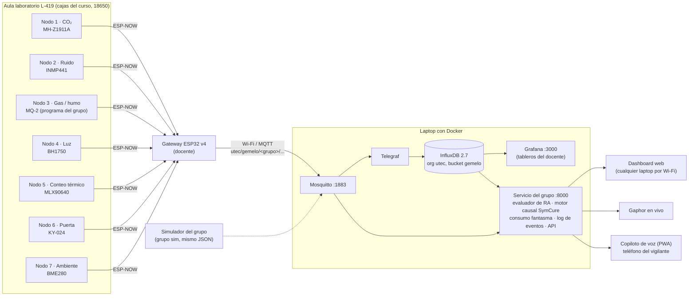

# Idea principal — Campus Twin L-419

> **Historial:** migrado el **10/11/2026** a la arquitectura oficial del curso (7 nodos ESP32 →
> ESP-NOW → Gateway → MQTT → laptop con Docker). La versión anterior (v2 del 10/09/2026, con
> Raspberry Pi, PZEM y nodos propios) está en git. Los cambios están en la
> [sección 14.2](#142-migración-a-la-arquitectura-oficial-10112026).

> Documento maestro del proyecto: consolida y completa
> [01-preformulacion.md](01-preformulacion.md) e [02-instrumentacion-l419.md](02-instrumentacion-l419.md).
> Los identificadores de requisito (NS, RF, RNF, CP y RA) son los mismos en este documento, en el
> modelo SysML de [modelo/](../modelo/) y en las tareas de Asana. Ningún identificador se
> renumera: los que ya no aplican quedan marcados como **retirados**.
>
> **Rótulos.** Todo resultado se rotula como **real** (medido con hardware), **simulado** (datos
> del simulador) o **pendiente**. Al 10/11/2026 **no hay ninguna medición real**: todo lo que
> funciona, funciona sobre datos simulados.

## 1. Resumen ejecutivo

Campus Twin es el **gemelo digital de un espacio de enseñanza de UTEC**: el aula laboratorio
**L-419**. Usa la **arquitectura oficial del curso**: siete nodos ESP32, cada uno con un sensor
(CO₂, ruido, gas, luz, conteo térmico de personas, puerta y ambiente), envían sus paquetes por
**ESP-NOW** a un **Gateway ESP32**, que los publica por Wi-Fi/MQTT en una **laptop con Docker**
(Mosquitto → Telegraf → InfluxDB → Grafana). El firmware de los nodos y del Gateway y ese stack
son **del docente** (J. F. Figueroa) y se reutilizan tal cual
([vendor/](../vendor/README.md), [contrato de datos](CONTRATO_DATOS.md)).

Al grupo no le tocó armar caja. Su aporte es la **integración**, que el sistema del docente no
cubre:

- la condición del aula frente a diez **requisitos de alto nivel** (RA-01..10, §8.6);
- el **diagnóstico causal** (SymCure) con causas, efectos y recomendaciones;
- el **log de eventos**, el **consumo fantasma** y el **dashboard propio**;
- el **gemelo en Gaphor**, el **simulador** y el **copiloto de voz** para el vigilante;
- un programa propio: el nodo de gas **MQ-2** (nodo 3), que el ZIP del docente no trae.

El diferenciador sigue siendo **cruzar las mediciones**. Con luz, ocupación y horario en la
misma serie temporal, el sistema responde algo que hoy nadie en el campus responde con evidencia:
*cuánta energía se gasta en un aula vacía*. Ese es el reporte de **consumo fantasma** (RF-10,
RA-08). Como el PZEM-004T no está en la arquitectura oficial, la energía se **estima por proxy**
(luces encendidas y aula vacía, multiplicadas por el inventario de potencias de
[config/aula_l419.yaml](../config/aula_l419.yaml)) y se presenta como estimación.

El sistema está pensado para funcionar **sin internet y sin nube** (RNF-05). Hay una excepción
conocida: el Gateway del docente toma la hora de `pool.ntp.org`, y sin hora Telegraf descarta los
mensajes. Se resuelve con NTP local en la laptop (pendiente, S15).

## 2. Necesidad, problema, causas y solución

| | |
|---|---|
| **Necesidad.** La universidad necesita operar sus espacios de enseñanza con evidencia: saber cuánta energía consumen, en qué condiciones ambientales se dictan las clases y qué pasa en ellos cuando están cerrados. | **Problema.** Hoy el laboratorio L-419 es una caja negra: el consumo solo se conoce agregado en la factura del edificio, el confort se reporta por queja y la vigilancia nocturna depende de lo que el vigilante alcanza a ver en su ronda. |
| **Causas.** (1) No hay instrumentación por espacio, solo medición general del edificio. (2) Instalar medición suele exigir intervenir el tablero eléctrico, lo que requiere permisos y paradas. (3) La información existente no llega a quien decide en el momento en que decide: el vigilante no tiene pantalla y el administrador no tiene datos por ambiente. | **Solución.** Un gemelo digital del laboratorio sobre la instrumentación no invasiva del curso (7 nodos a batería, sin tocar el tablero), un servidor local en una laptop, un diagnóstico causal frente a requisitos de condición del aula y dos interfaces: dashboard web para análisis y copiloto de voz para operación en campo. |

## 3. Stakeholders

| Stakeholder | Qué le importa | Qué obtiene del sistema | Cómo participa |
|---|---|---|---|
| **Vigilante nocturno** | Hacer la ronda rápido, sin cargar equipo, y no perderse un incidente | Briefing de turno por voz y consultas orales desde un teléfono (RF-09), alertas de puerta, gas o humo y aula ocupada fuera de horario (RF-04, RF-08, RA-05, RA-09) | Entrevista de necesidades y prueba de uso del copiloto (S16). La vigilancia es tercerizada: la entrevista y la prueba requieren autorización de Seguridad del campus y del contratista |
| **Administrador de infraestructura / Servicios Generales** | Reducir consumo y sustentarlo con datos (LEED/EDGE) | Dashboard con consumo fantasma estimado en kWh, S/ y kg CO₂, históricos y desglose por carga (RF-01, RF-06, RF-07, RF-10, RF-12, RA-08) | Autoriza la instalación y entrega el inventario de potencias, la tarifa y el horario que alimentan la estimación |
| **Coordinador del laboratorio / docentes** | Que el ambiente sea apto para clase y equipos | Temperatura, humedad, CO₂, iluminancia y ruido en vivo frente a norma (RF-02, RA-01..04, RA-07) y alertas de confort (RF-08) | Define horarios de acceso e interpreta umbrales |
| **Seguridad del campus** | Detectar accesos fuera de horario y emergencias | Eventos de puerta (KY-024) con alerta, gas o humo (MQ-2) y conteo de ocupantes para evacuar (RF-04, RA-05, RA-06, RA-09) | Define el horario, el protocolo de alerta y autoriza la participación del vigilante |
| **Estudiantes del laboratorio** | Privacidad | Sin cámaras: la MLX90640 es una matriz térmica de 32×24 que no forma imágenes identificables y solo envía conteos; el INMP441 solo envía niveles en dB (RNF-02) | Restricción de diseño, no negociable |
| **Equipo PI3 y docente del curso** | Demo en vivo y entregables a tiempo; el docente, además, que se respete su arquitectura | Simulador en el formato del Gateway (RF-11), sistema estable 72 h (RNF-06) y reconocimiento explícito del código del docente | Ejecuta el proyecto; el docente evalúa y es dueño del firmware y del stack |
| **Grupos del curso que arman las cajas y S1 G1 (procesador central)** | Que su caja funcione dentro del sistema común | Un consumidor más de los datos del Gateway, sin cambiar sus tópicos ni campos | Arman los nodos (S8 G2, S8 G4, S9 G2, S9 G3, S9 G5, S1 G1 y S1 G5) y operan el Gateway real. Hay que coordinar con ellos el `GRUPO` y la IP del Gateway |
| **Red / TI de UTEC** | No abrir huecos en la red del campus | Solo el Gateway se conecta al Wi-Fi; los nodos hablan ESP-NOW con él (RNF-05, RNF-08) | Autoriza o no el uso de la red "UTEC Proyectos" o de un router propio |

## 4. Alcance: el laboratorio L-419 como piloto

El piloto es el **aula laboratorio L-419**. Con la arquitectura oficial, eso significa:

| Condición | Qué implica |
|---|---|
| **Cajas a batería** (ESP32 DevKit, sensor, protoboard, 18650 de 1600 mAh y porta-batería) | Los nodos se instalan sin cablear ni tocar el tablero. La autonomía depende del consumo de cada sensor: el MH-Z1911A y el MQ-2 calientan y consumen mucho, así que para medir de noche y por días seguidos (RF-10, RNF-06) hace falta USB o recarga. El análisis va en [06-energia-cajas.md](06-energia-cajas.md) (en elaboración). |
| **Wi-Fi solo para el Gateway** | Los nodos no se conectan al Wi-Fi: solo lo escanean para hallar el canal del Gateway y le envían por ESP-NOW. El Gateway publica por MQTT en la laptop. Si TI no autoriza la red, se usa un router propio o un punto de acceso (RNF-05). |
| **Siete posiciones fijas** | La ubicación de cada nodo y de los objetos del aula (puerta, ventana, aire acondicionado, proyector, pizarra y tablero) está en `config/aula_l419.yaml` → `plano`, todavía como supuesto hasta tomar el croquis. |
| **Equipos propios del laboratorio** (PC, proyector, aire acondicionado) | Son las cargas que hacen interesante el consumo fantasma. Sin medidor de energía, sus potencias salen del inventario de `config/aula_l419.yaml`. |

**Dentro del alcance:** un espacio (L-419); integración de los **7 nodos oficiales** y del
Gateway; el **programa del nodo MQ-2**; servidor en la laptop (stack del docente + servicios del
grupo por `docker-compose.override.yml`); RA-01..10 con su grafo causal y motor SymCure; log de
eventos; consumo fantasma estimado; dashboard web en la red local; gemelo en Gaphor en vivo;
simulador en el formato del Gateway; copiloto de voz en español desde un teléfono en la red local.

**Fuera del alcance (declarado):** armar las cajas (las arman otros grupos del curso); modificar el
firmware de los nodos, del Gateway o el stack del docente (se usan tal cual, y lo que se adapte
va en una carpeta propia); medición directa de energía (el PZEM no está en la arquitectura
oficial); control de actuadores (el sistema informa, no apaga cargas); gemelo 3D fotorrealista (se
usa un plano 2D); escalamiento a todo el campus (se documenta cómo replicar, no se replica);
reconocimiento de personas o cámaras; reconocimiento de hablante o palabra de activación ("wake
word"): el copiloto se activa con un botón; acceso al sistema desde fuera de la red local; roles
múltiples en el dashboard.

## 5. ODS

| ODS | Cómo lo aborda el proyecto |
|---|---|
| **7 — Energía asequible y no contaminante** | Estima y ayuda a reducir el consumo evitable; el reporte de consumo fantasma cuantifica el desperdicio. |
| **11 — Ciudades y comunidades sostenibles** | Instrumenta infraestructura educativa existente sin obra civil, con un método replicable a otros ambientes. |
| **13 — Acción por el clima** | Traduce kWh evitados a emisiones evitadas con el factor de emisión de la red peruana (SEIN), configurable. |
| **4 — Educación de calidad** (secundario) | Condiciones ambientales aptas para el dictado y un laboratorio que sirve de caso de estudio. |
| **9 — Innovación e infraestructura** (secundario) | Gemelo digital de bajo costo con hardware abierto, documentado para reproducirse. |

## 6. Arquitectura de la solución

**Cadena de datos:** sensor → ESP32 → ESP-NOW (paquete binario de `paquetes.h`) → Gateway →
Wi-Fi/MQTT (JSON) → Mosquitto → Telegraf → InfluxDB → servicio del grupo → dashboard, Gaphor y
voz. El formato completo está en [CONTRATO_DATOS.md](CONTRATO_DATOS.md). Ningún nodo lleva cable de
datos ni se conecta a 220 V, y la instalación no perfora paredes ni corta conductores (RNF-01).

| Subsistema | Responsabilidad | Autoría | Bloque en el modelo SysML |
|---|---|---|---|
| Subsistema de Sensado | 7 nodos ESP32 con su sensor: miden, calculan sus niveles y bits de anomalía y envían por ESP-NOW | Firmware del docente; el nodo MQ-2 lo programa el grupo | `Nodo Sensor ESP32` y sus especializaciones |
| Gateway | Recibir por ESP-NOW, contar las muestras perdidas, publicar JSON por MQTT y su estado por LWT | Docente | Gateway (se agrega en la migración del modelo) |
| Servidor (laptop) | Mosquitto, Telegraf, InfluxDB y Grafana en Docker | Docente (stack) y grupo (`deploy/`) | `Servidor Campus Twin` |
| Servicios del grupo | Evaluador de RA, motor causal, consumo fantasma, log de eventos, API, simulador y supervisión de salud | Grupo ([demo/servidor/gemelo/](../demo/servidor/gemelo/)) | `Servidor Campus Twin` (servicios del grupo) |
| Dashboard Web | Mediciones, condición por RA, causas, efectos y recomendaciones, plano, fantasma, salud y log | Grupo ([demo/tablero/](../demo/tablero/)) | `Dashboard Web` |
| Gemelo en Gaphor | Modelo SysML que se colorea en vivo según la condición de cada RA | Grupo ([modelo/](../modelo/)) | — |
| Copiloto de Voz | Briefing y consultas orales | Grupo (pendiente, S16) | `Copiloto de Voz` |
| Red Local | ESP-NOW entre nodos y Gateway; Wi-Fi entre Gateway, laptop y clientes | Curso | `Red Local` |
| Subsistema de Alimentación | 18650 por caja (o USB) y la laptop | Curso | `Subsistema de Alimentación` |

### 6.1 Decisiones técnicas

Las decisiones de la EC3 están numeradas D1–D9 en
[05-plan-cierre.md §1](05-plan-cierre.md#1-arquitectura-objetivo). Esta tabla las resume junto con
las que vienen de la arquitectura oficial.

| Decisión | Elección | Por qué |
|---|---|---|
| Transporte nodo → Gateway | ESP-NOW con los paquetes de `paquetes.h` (`PROTO_VERSION 1`, ≤ 250 B) | Lo fija la arquitectura del docente. Consume menos que Wi-Fi con MQTT |
| Transporte Gateway → servidor | MQTT, QoS 0, tópico `utec/gemelo/<grupo>/nodo<id>/<tipo>` y JSON plano; estado por LWT en `.../gateway/estado` | Lo fija el Gateway del docente. **No se cambian tópicos ni campos** |
| Broker, base de datos y gráficos | Mosquitto, Telegraf, InfluxDB 2.7 (org `utec`, bucket `gemelo`) y Grafana, del docente | Es el stack oficial. Los servicios del grupo se agregan con `docker-compose.override.yml` |
| Servidor | Laptop con Docker; `deploy/levantar.sh` levanta todo con un comando | La Raspberry Pi 5 ya no está en la arquitectura |
| Salidas del grupo | Tópicos `utec/gemelo/<grupo>/campustwin/{ra,diagnostico,evento}` y measurements `ra`, `diagnostico` y `evento` (D4) | No se toca el contrato del docente y Grafana también puede mostrar el diagnóstico |
| Datos simulados | El simulador publica el JSON exacto del Gateway con el grupo `sim` (D3) | Para pasar a datos reales basta cambiar `grupo` en `config/nodos.yaml` |
| Estado vivo e histórico | Vivo por MQTT, histórico por InfluxDB (D2) | Latencia mínima y se usa la base del docente |
| Requisitos y grafos | `config/requisitos_ra.yaml`, `config/aula_l419.yaml` y `grafos/ra-XX-*.yaml` (D5) | Sin números mágicos y editables sin tocar código |
| Razonamiento | SymCure: valores V, F, S y D; entradas OR, AND, N/M e IF; salidas AND u OR; propagación aguas arriba y aguas abajo (D6) | Es lo que enseña el docente y evalúa la pauta |
| Energía | Estimación por proxy, sin PZEM (D7) | El PZEM no está en la arquitectura oficial |
| Programa propio | `MQ-2.ino`, nodo 3, con la estructura de `nodo_co2.ino` (D8) | Es el único nodo sin programa |
| API, reglas y dashboard | Python (FastAPI) y React; el tablero se sirve en `0.0.0.0:8000` a cualquier laptop de la red | Una sola base de código; Cytoscape empaquetado, sin CDN, para funcionar sin internet |
| Hora | En la demo de la EC3 la pone el simulador (D9). Antes de instalar en el L-419, **NTP local en la laptop** | Sin `ts`, Telegraf descarta el mensaje completo |
| Idempotencia y pérdidas | El Gateway cuenta las muestras perdidas por huecos en `seq` (`perdidos`); un `seq` que retrocede indica reinicio del nodo | Es lo que trae el firmware del docente; no hay buffer ni reenvío en el nodo |
| Voz | PWA en el teléfono con activación por botón. Motor de voz por decidir en S16: STT y TTS locales en la laptop (faster-whisper y Piper) o la voz del navegador | La voz del navegador puede depender de la nube en Android, lo que choca con RNF-05 |
| Firmware | Arduino IDE (`.ino`), nombrado con el código del sensor, como pide el anuncio del 02/11; credenciales fuera de git | `gateway.ino` y `servidor_iot/.env` del docente traen claves: se versionan sus `.example` |

## 7. Casos de uso principales

1. **Briefing de ronda (vigilante, 22:00).** Abre la app de voz en el teléfono, pulsa
   "briefing" y el copiloto responde: estado de puerta, ocupación, consumo fantasma estimado y si
   hay algo anómalo desde el turno anterior. → RF-09, RF-08.
2. **Consulta durante la ronda (vigilante, 01:30).** Frente al L-419 pulsa el botón y pregunta
   *"¿hay alguien adentro?"*; el copiloto responde en menos de 5 s con el conteo térmico. Si no
   entiende, lo dice y pide repetir. → RF-09.
3. **Consumo fantasma (administrador, cierre de mes).** El dashboard reporta cuántos kWh se
   estima que se consumieron con el aula vacía, por franja horaria y por carga, y el ahorro de
   corregirlo. → RF-10, RF-01, RF-12, RF-03, RA-08.
4. **Confort en clase (coordinador, media mañana).** El CO₂ pasa de 1000 ppm con el aula llena y
   la puerta cerrada; el RA-03 pasa a alerta, el grafo señala ventilación insuficiente y
   recomienda abrir la puerta, y queda en el log. → RF-02, RF-08, RA-03.
5. **Apertura fuera de horario (seguridad, 03:00).** El KY-024 detecta la puerta abierta fuera del
   horario oficial: el RA-09 se viola, se registra el evento y el copiloto lo anuncia en la
   siguiente consulta del vigilante. → RF-04, RF-08, RA-09.
6. **Gas o humo (cualquier hora).** El MQ-2 baja su Rs/R0 o activa `GAS_DETECTADO`: el RA-05 pasa
   a crítico, el dashboard muestra el conteo de ocupantes para evacuar y la recomendación. →
   RF-08, RA-05, RA-06.
7. **Nodo o Gateway caído (equipo, cualquier día).** Un nodo deja de reportar por más de tres
   periodos propios: el dashboard lo marca y el RA-10 diagnostica batería o falla. Si caen todos a
   la vez, la lógica N/M diagnostica "Gateway" y no "7 sensores rotos". → RF-13, RF-08, RA-10.
8. **Demo sin hardware (equipo, EC3 y demo final).** El simulador publica en el formato del
   Gateway con el grupo `sim`; el operador activa escenarios desde el dashboard, que muestra la
   franja **DATOS SIMULADOS**. → RF-11.

## 8. Requisitos

### 8.1 Necesidades de stakeholder (NS)

| ID | Necesidad | Enunciado |
|---|---|---|
| NS-1 | Ronda informada | El vigilante nocturno necesita conocer el estado del laboratorio durante su ronda sin cargar una laptop. |
| NS-2 | Consumo bajo control | El administrador de infraestructura necesita evidencia medible del consumo para reducirlo y sustentar certificaciones. |
| NS-3 | Ambiente apto | El coordinador del laboratorio necesita temperatura, humedad y CO₂ aptos para las clases y los equipos. |
| NS-4 | Acceso vigilado | Seguridad del campus necesita detectar aperturas o manipulaciones del laboratorio fuera de horario. |
| NS-5 | Demostración reproducible | El equipo de PI3 necesita una demo en vivo que funcione sin depender de la red del campus. |
| NS-6 | Red segura | TI de UTEC necesita que los dispositivos del proyecto no abran huecos ni interfieran en la red del campus. |
| NS-7 | Privacidad | Los estudiantes y el personal del laboratorio necesitan que el sistema no los identifique ni grabe. |

### 8.2 Requisitos funcionales (RF)

La columna **Estado** usa los rótulos del proyecto: real, simulado o pendiente.

| ID | Requisito | Criterio de aceptación | Deriva de | Bloque que lo satisface | Se verifica con | Estado al 10/11 |
|---|---|---|---|---|---|---|
| RF-01 | Medición de energía total | **Estimación** de la potencia y la energía del aula por proxy, sin PZEM: luces encendidas (BH1750, nodo 4), aula vacía u ocupada (MLX90640, nodo 5), aire acondicionado encendido (ruido mecánico del INMP441, nodo 2) y horario, multiplicados por el inventario de potencias de `config/aula_l419.yaml`; actualización ≤ 10 s. Se presenta siempre como estimación, porque no hay instrumento patrón contra el cual medir su error. Si el docente integra el PZEM-004T como nodo 8, RF-01 pasa a medición directa (tensión, corriente, potencia, factor de potencia y energía) con error ≤ ±2 % | NS-2 | Servicios del grupo (consumo fantasma) | CP-06 | Simulado |
| RF-02 | Medición ambiental | Temperatura (±1 °C), humedad (±3 % HR) y presión con el BME280 (nodo 7); CO₂ (±50 ppm + 5 % de la lectura) con el MH-Z1911A (nodo 1); iluminancia (±20 %) con el BH1750 (nodo 4) y nivel sonoro en dB con el INMP441 (nodo 2, aproximado mientras no se calibre), con periodo ≤ 60 s (los nodos del docente envían cada 1 a 10 s). Exactitudes según hoja de datos, verificadas por consistencia | NS-3 | Nodos 1, 2, 4 y 7 | CP-07 | Simulado |
| RF-03 | Estimación de ocupación | **Conteo** de entradas y salidas sin cámaras con la matriz térmica MLX90640 (nodo 5) en el marco superior de la puerta, coordinada con el KY-024 (nodo 6); el conteo lo hace el ESP32 con el código del docente. Error ≤ ±2 con hasta 10 personas entrando de a una; la ocupación estimada nunca baja de 0 y el nodo marca sus correcciones (`CONTEO_CORREGIDO`). La **presencia** (aula vacía u ocupada) se deriva del conteo, con acierto ≥ 95 % y latencia ≤ 30 s. El consumo fantasma usa solo la presencia | NS-1, NS-3 | Nodos 5 y 6 | CP-02 | Simulado |
| RF-04 | Eventos de puerta | Apertura y cierre registrados en ≤ 10 s con el KY-024 (nodo 6), que envía en el acto ante un cambio y cada 10 s (ese envío periódico hace de latido); una apertura prolongada (≥ 10 min, bit `PUERTA_ABIERTA_PROLONGADA`) genera un solo evento de apertura y uno de cierre. La detección de vibración se retiró con el SW-420, que no está en la arquitectura oficial | NS-4 | Nodo 6 | CP-08 | Simulado |
| RF-05 | Transporte de datos | Nodo → Gateway por ESP-NOW y Gateway → Mosquitto por Wi-Fi/MQTT, en el formato de [CONTRATO_DATOS.md](CONTRATO_DATOS.md). Cada paquete lleva `seq`: el Gateway cuenta las muestras perdidas por huecos (`perdidos`), un `seq` que retrocede indica reinicio del nodo y el estado del Gateway se publica retenido por LWT (`online` u `offline`). El firmware oficial usa QoS 0 y una cola de 32 mensajes en el Gateway, sin buffer ni reenvío en el nodo: las pérdidas se miden y se reportan, no se recuperan | NS-5 | Red Local y Gateway | CP-03 | Simulado (formato); pendiente en hardware |
| RF-06 | Histórico y consulta | Retención ≥ 60 días en el InfluxDB 2.7 del docente (bucket `gemelo`, sin límite de retención configurado) en el disco de la laptop; al cierre, todos los datos reales desde la instalación en el L-419 (S15), y ≥ 4 semanas continuas si el curso continúa; consulta por rango, magnitud y agregación (crudo, 1 min, 1 h, 1 día) en Flux, en Grafana (con exportación a CSV) y en la API del grupo | NS-2 | InfluxDB y API del grupo | CP-09 | Simulado |
| RF-07 | Dashboard web | Estado en vivo con refresco ≤ 5 s, condición de cada RA, causas, efectos y recomendaciones, históricos, plano 2D del laboratorio, reporte de ahorro y panel de salud, accesible en la red local sin internet desde cualquier laptop (`http://<ip>:8000`); los tableros de Grafana del docente (`:3000`) quedan enlazados | NS-2 | Dashboard Web | CP-09 | Simulado |
| RF-08 | Alertas por reglas | Reglas configurables en archivo (`config/requisitos_ra.yaml`, una por RA-01..10): consumo con el aula vacía, CO₂ alto, gas o humo, puerta fuera de horario y nodo sin reportar. La batería agotada se ve como nodo sin datos, porque el paquete del docente no trae nivel de batería. Notificadas en dashboard, log de eventos y voz, con silencio configurable para no repetir la misma alerta más de una vez cada 15 min | NS-1, NS-4 | Servicios del grupo (evaluador de RA y motor causal) | CP-10 | Simulado |
| RF-09 | Copiloto de voz | App web en el teléfono del vigilante con activación por botón: briefing de turno y respuesta a consultas orales en español en ≤ 5 s desde el fin del habla, con al menos 8 intenciones cerradas (estado general, puerta, ocupación, consumo, temperatura, CO₂, alertas pendientes, última apertura) y respuesta de "no entendí, repite" cuando la confianza es baja | NS-1 | Copiloto de Voz | CP-04 | Pendiente (S16) |
| RF-10 | Detección de consumo fantasma | Reporte de la energía **estimada** (RF-01) con el aula desocupada y luces o equipos encendidos por ≥ 10 min consecutivos (umbral de alerta de RA-08), dentro y fuera del horario oficial, desglosado por franja horaria y por carga, con ahorro estimado en S/ y kg CO₂ usando tarifa y factor de emisión configurables | NS-2 | Servicios del grupo (consumo fantasma) | CP-06 | Simulado |
| RF-11 | Modo demostración y simulador | Generación de datos sintéticos en el formato exacto del Gateway (grupo `sim`, `utec/gemelo/sim/nodo<id>/<tipo>`) para desarrollar sin hardware, con escenarios y reproducción de datos grabados, activable por nodo o para todo el sistema, con la franja **DATOS SIMULADOS** visible en dashboard y voz | NS-5 | Simulador del grupo | CP-11 | Simulado (escenarios); grabación y reproducción en curso |
| RF-12 | Medición de energía por carga | **Desglose estimado** del consumo por tipo de carga (luminarias, PC, proyector y aire acondicionado) con el inventario de `config/aula_l419.yaml` y la señal de cada carga (BH1750 para luces, ruido mecánico del INMP441 para el aire, fracción supuesta de PC encendidos), sin internet. Los enchufes inteligentes con Tasmota quedaron fuera de la arquitectura oficial | NS-2 | Servicios del grupo (consumo fantasma) | CP-06 | Simulado |
| RF-13 | Supervisión de salud del sistema | Por nodo: última muestra, muestras perdidas (`perdidos` del Gateway) y reinicios (`seq` y `uptime_ms`); por Gateway: estado por LWT; por servidor: servicios arriba. Un nodo se marca caído tras tres periodos propios sin reportar, con un mínimo de 30 s (`config/requisitos_ra.yaml`, RA-10), y si cae ≥ 60 % a la vez se sospecha del Gateway. Muestras perdidas ≤ 1 % en una semana. La intensidad de señal y la batería no vienen en el paquete del docente: quedan pendientes | NS-5 | Servicios del grupo (salud, RA-10) | CP-15 | Simulado |

### 8.3 Requisitos no funcionales y restricciones (RNF)

| ID | Restricción | Criterio de aceptación | Deriva de | Se verifica con | Estado al 10/11 |
|---|---|---|---|---|---|
| RNF-01 | Instalación no invasiva y segura | Sin perforar paredes ni cortar o desconectar conductores: cajas con montaje adhesivo (cinta VHB) o bridas. Ningún nodo se conecta a 220 V: se alimentan con la 18650 de la caja o con USB de 5 V | NS-5 | CP-12 | Pendiente (instalación en S15) |
| RNF-02 | Privacidad por diseño | Sin cámaras: la MLX90640 es una matriz térmica de 32×24 que no forma imágenes identificables y no sale del nodo (solo envía conteos); el INMP441 procesa el audio en el nodo y solo envía niveles en dB; el audio del copiloto se procesa en memoria y se descarta, guardando solo el texto de la intención reconocida y de la respuesta; ocupación reportada de forma agregada; no se registra quién consulta | NS-4, NS-7 | CP-12 | Cumplido por diseño: verificado en el código el 11/11 ([CP-12](pruebas/CP-12-privacidad.md)); el copiloto se revisa en S16 |
| RNF-03 | Presupuesto acotado | El hardware de sensado y el Gateway los compró el curso (OC-UTEC-004033-26) y no se cargan al grupo. El gasto propio del grupo, si lo hay, se registra y no supera el tope de S/ 2808 de la propuesta original | NS-5 | CP-14 | Pendiente CP-14 |
| RNF-04 | Autonomía del nodo de puerta | Nodo 6 (ESP32 DevKit + KY-024) con la 18650 de 1600 mAh de la caja: meta ≥ 30 días. El firmware del docente envía cada 10 s sin sueño profundo, así que la meta solo se alcanza enviando por evento (interrupción del KY-024) más un latido, coordinado con el docente, o con USB. La autonomía se calcula en el análisis de energía de las cajas y se mide en S15. Sin nivel de batería en el paquete, la batería agotada se detecta como nodo sin datos (RA-10) | NS-4 | CP-13 | Estimado: no se cumple con el firmware actual ([06-energia-cajas.md](06-energia-cajas.md)); medición pendiente en S15 |
| RNF-05 | Operación autónoma sin internet | Todo el sistema (nodos, Gateway, servidor, dashboard, voz y hora) opera sobre la red local sin conexión a internet; ningún componente depende de una nube. El Gateway del docente toma la hora de `pool.ntp.org`: sin internet `ts` sale `null` y Telegraf descarta el mensaje, así que hace falta NTP local en la laptop | NS-5, NS-6 | CP-03 | Pendiente (NTP local en S15) |
| RNF-06 | Disponibilidad para la demo | 72 h continuas sin intervención manual antes de la presentación; servicios Docker y nodos con arranque automático (nodos con USB durante el ensayo); respaldo diario de InfluxDB a un disco USB | NS-5 | CP-05 | Pendiente (S16) |
| RNF-07 | Configurabilidad | Pines, umbrales, intervalos, horario oficial, tarifa, factor de emisión y endpoints en configuración; sin credenciales en el repositorio | NS-5 | CP-14 | Cumplido en el software del grupo (`config/`, `.env.example`); pendiente CP-14 |
| RNF-08 | Seguridad básica de acceso | Red propia con WPA2 y clave; broker MQTT con usuario y contraseña; dashboard y API con inicio de sesión; HTTPS con certificado propio; sin puertos expuestos hacia la red del campus | NS-6 | CP-14 | Pendiente: el Mosquitto y el Gateway del docente aceptan conexiones anónimas; hay que coordinarlo con el docente |
| RNF-09 | Montaje de las cajas | Cada caja se fija con cinta VHB o bridas, sin perforar (RNF-01), en la posición y altura de [02-instrumentacion-l419.md](02-instrumentacion-l419.md) §2: el CO₂ a 1.5 m (zona de respiración), el térmico en el marco superior de la puerta a 2.3 m apuntando al vano, el imán del KY-024 en la hoja de la puerta. Se retira sin herramientas para cambiar la batería o reprogramar, y el cable USB, si lo hay, va por canaleta | NS-5 | CP-16 | Pendiente (instalación en S15) |
| RNF-10 | Operación de la caja | Interruptor de encendido accesible desde fuera (guía de cajas del curso). Apertura frente al sensor que no lo tape ni lo sesgue: rejilla para el MH-Z1911A, el MQ-2 y el BME280 (el aire debe llegar por difusión), ventana abierta para la MLX90640 (el plástico común no deja pasar el infrarrojo térmico) y el BH1750, y orificio frente al INMP441. El micro-USB queda accesible para alimentar y reprogramar sin abrir la caja. En la caja del MQ-2, el calefactor (~0.75 W) queda separado del resto y con ventilación | NS-5 | CP-16 | Pendiente (S15) |
| RNF-11 | Dimensiones y fabricación | Diseño para impresión 3D (guía de cajas del curso) que aloje el ESP32 DevKit V1 de 30 pines, la protoboard de 170 puntos, el sensor, la 18650 con su porta-batería y el regulador, con holgura para los cables. Las medidas se toman de los componentes en el L-414: el grupo no tiene caja asignada ni los archivos del diseño, así que aquí no se fija ninguna cifra | NS-5 | CP-16 | Pendiente: medidas en el L-414 (S15) |
| RNF-12 | Energía de la caja | Si la caja va a batería: TP4056 con protección, LDO de 3.3 V (nodos de 3.3 V) o elevador a 5 V (MQ-2 y MH-Z1911A, que deben aguantar picos de 300-400 mA) e interruptor. El Gateway y los nodos 1 (CO₂), 3 (gas) y 5 (térmico) van por USB fijo de 5 V; el del MQ-2, de 1 A. La autonomía de cada caja queda estimada antes de armarla y se mide en S15 | NS-5 | CP-13 | Estimado ([06-energia-cajas.md](06-energia-cajas.md)): con el firmware actual ninguna caja pasa un día con la 18650, la recarga con luz ambiental no alcanza, y el regulador y el TP4056 no se compraron; medición pendiente (S15) |

### 8.4 Casos de prueba (CP)

| ID | Ensayo | Verifica | Estado al 10/11 |
|---|---|---|---|
| CP-01 | **Retirado el 10/11/2026.** Era la exactitud de energía contra multímetro y carga conocida (PZEM y enchufes). El PZEM y los enchufes no están en la arquitectura oficial y la energía se estima por proxy, así que no hay medición que contrastar; la coherencia de la estimación pasa a CP-06. También se eliminó en Asana. El número no se reutiliza | — | Retirado |
| CP-02 | Conteo con la MLX90640 y el KY-024: 10 entradas y 10 salidas de a una, más cruces de dos personas a la vez; presencia derivada (aula vacía u ocupada) contra la observación | RF-03 | Pendiente (S15) |
| CP-03 | Resiliencia de red y sin internet: Gateway caído (LWT `offline`), caída del router y del servidor, cambio de canal del router (ESP-NOW), conteo de muestras perdidas por huecos de `seq`, y todo el sistema (voz incluida) con la red sin salida a internet y NTP local | RF-05, RNF-05 | Simulado (Gateway caído); pendiente en hardware |
| CP-04 | Copiloto de voz: 20 consultas por 2 hablantes en la app del teléfono, con ruido de pasillo; latencia y aciertos | RF-09 | Pendiente (S16) |
| CP-05 | Maratón de 72 horas sin intervención, con un corte de energía provocado | RNF-06 | Pendiente (S16) |
| CP-06 | Auditoría de consumo fantasma, contrastada con el horario oficial: con datos simulados en S14 y con una semana de datos reales si el curso continúa. Revisa también la coherencia de la estimación por proxy y su desglose por carga contra el inventario | RF-10, RF-01, RF-12 | Simulado ([informe](pruebas/CP-06-consumo-fantasma.md)); con datos reales, pendiente |
| CP-07 | Verificación de consistencia ambiental: BME280 contra termohigrómetro de referencia; MH-Z1911A con calibración al aire exterior (≈ 420 ppm) y coherencia con la ocupación; BH1750 con luces encendidas y apagadas; INMP441 contra un sonómetro, si se consigue | RF-02 | Pendiente (S15) |
| CP-08 | Eventos de puerta con el KY-024: apertura, cierre, apertura prolongada (≥ 10 min) y portazo con rebote (antirrebote de 150 ms) | RF-04 | Pendiente (S15) |
| CP-09 | Histórico, API y dashboard: consultas por rango y agregación, refresco y panel de salud | RF-06, RF-07 | Simulado |
| CP-10 | Reglas de alerta: disparo, silencio, umbral configurable y alerta de nodo caído | RF-08 | Simulado |
| CP-11 | Modo demostración con hardware desconectado, total y por nodo, con la franja DATOS SIMULADOS | RF-11 | Simulado (grabación y reproducción de punta a punta, 10/11; [pruebas](pruebas/README.md)) |
| CP-12 | Revisión de instalación no invasiva, seguridad eléctrica y privacidad | RNF-01, RNF-02 | Privacidad: hecha, real por revisión de código ([informe](pruebas/CP-12-privacidad.md)). Instalación: pendiente (S15) |
| CP-13 | Autonomía de las cajas con 18650, empezando por el nodo de puerta: consumo estimado por nodo, luego medido en el L-414, y proyección de autonomía | RNF-04, RNF-12 | Estimación hecha ([06-energia-cajas.md](06-energia-cajas.md)); medición pendiente (S15) |
| CP-14 | Auditoría de costos, de configuración del repositorio y de credenciales | RNF-03, RNF-07, RNF-08 | Real, por revisión del repositorio ([informe](pruebas/CP-14-auditoria-repositorio.md)) |
| CP-15 | Supervisión: apagar un nodo y verificar marca de caído, alerta y métrica de muestras perdidas | RF-13 | Simulado |
| CP-16 | Inspección de las cajas: montaje y posición (RNF-09), interruptor, aperturas y acceso al micro-USB (RNF-10), y que cada componente entre en la caja impresa (RNF-11), con foto de cada caja instalada | RNF-09, RNF-10, RNF-11 | Pendiente (S15) |

### 8.5 Casos borde y comportamiento esperado

Cada situación tiene un comportamiento definido y un requisito que lo cubre. Si aparece un caso
nuevo, se agrega aquí antes de programarlo.

| Situación | Comportamiento esperado | Cubierto por |
|---|---|---|
| El Gateway no tiene internet para NTP | `ts` sale `null` y Telegraf descarta el mensaje completo (comprobado el 10/11). En la EC3 la hora la pone el simulador; antes de instalar, NTP local en la laptop | RNF-05, RF-05 |
| Se cae el Gateway | Mosquitto publica `offline` por LWT y todos los nodos dejan de llegar a la vez; el RA-10 diagnostica "Gateway" por la lógica N/M, no siete sensores rotos | RF-13, RA-10 |
| El router cambia de canal | Los nodos buscan el canal del Gateway por SSID al arrancar y otra vez tras 10 envíos fallidos seguidos (`espnow_nodo.h` del docente, re-escaneo de unos 2 s): mientras tanto se pierden muestras, que quedan como huecos en `seq`. El grafo del RA-10 lo sugiere como causa | RF-05, RA-10 |
| Se llena la cola del Gateway (32 mensajes) | Se pierden mensajes y aparecen como huecos de `seq` en `perdidos` | RF-05, RF-13 |
| Un nodo se reinicia | `seq` retrocede y `uptime_ms` vuelve a cero; se registra como reinicio, no como pérdida | RF-13 |
| Se agota la batería de un nodo | El nodo deja de llegar; a los tres periodos propios (mínimo 30 s) se marca caído y el RA-10 sugiere batería o apagado | RF-13, RNF-04, RA-10 |
| El MH-Z1911A está calentando (3 min) o no responde | `nivel` es `CALENTANDO`, o `co2_ppm` vale −1 o −2 con `FALLO_SENSOR`; el RA-03 queda desconocido y no se alerta | RF-02, RA-03, RA-10 |
| El MQ-2 está calentando o sin calibrar | `calentando = 1` o `rs_r0` nulo: el RA-05 queda desconocido; el grafo lo muestra como causa posible de una lectura dudosa | RA-05 |
| El BME280 falla | `temp_c` llega `null` con `FALLO_SENSOR`; RA-01 y RA-02 quedan desconocidos | RF-02, RA-10 |
| Varias personas cruzan la puerta a la vez | El nodo térmico cuenta cruces dudosos y corrige (`CONTEO_CORREGIDO`); el conteo es una estimación (±2) | RF-03 |
| Conteo negativo | El nodo limita la ocupación estimada a 0 | RF-03 |
| Objeto caliente quieto en la vista de la MLX90640 | El nodo lo marca `OBJETO_ESTATICO` y no lo cuenta como persona | RF-03 |
| Puerta abierta por mucho tiempo | A los 10 min el nodo marca `PUERTA_ABIERTA_PROLONGADA`: un evento de apertura y uno de cierre, sin alertas repetidas | RF-04, RF-08 |
| Rebote del Hall al cerrar de golpe | Antirrebote de 150 ms en el nodo | RF-04, CP-08 |
| Luz natural confundida con luces encendidas | Se resta la luz natural esperada para la hora; sus parámetros son supuestos en `config/aula_l419.yaml` hasta medirlos de noche y a mediodía | RF-01, RF-10 |
| Nivel sonoro sin calibrar | dB SPL ≈ dBFS + 120 en el nodo del docente; RA-07 se presenta como aproximado hasta calibrar | RF-02, RA-07 |
| Cambio de horario oficial, feriado o semana sin clases | Horario en `config/aula_l419.yaml`; "fuera de horario" se evalúa contra ese horario | RNF-07, RF-08 |
| Datos del aula todavía supuestos | Cada valor lleva `supuesto: true` y su fuente; el dashboard muestra cuántos quedan | RNF-07 |
| Mezcla de datos reales y simulados | Cada mensaje lleva la tag `grupo` (`sim` o el del Gateway real); con `sim` el dashboard muestra DATOS SIMULADOS y el reporte lo rotula | RF-11, RF-10 |
| Un nodo falla el día de la demo | Reproducción de datos grabados o escenario del simulador, con la franja DATOS SIMULADOS | RF-11 |
| Se pierde una credencial | Credenciales en archivos locales fuera del repo (`deploy/.env`, `gateway.ino`), con `.example` versionado | RNF-07, RNF-08 |
| El teléfono del vigilante sale de la cobertura Wi-Fi | La app muestra "sin conexión" y ofrece reintentar; no hay respuesta silenciosa | RF-09 |
| El navegador bloquea el micrófono | La app se sirve por HTTPS con certificado propio instalado en el teléfono del equipo | RF-09, RNF-08 |
| El copiloto no entiende la consulta | Responde "no entendí, repite" y muestra en pantalla las consultas que sí entiende | RF-09 |
| Ruido de fondo alto | Activación por botón y frases cortas; se ensaya con ruido de pasillo en CP-04 | RF-09, CP-04 |
| Consulta fuera del horario nocturno | El copiloto responde igual; el briefing automático solo se ofrece entre 22:00 y 06:00 | RF-09 |
| Lectura fuera de rango físico (CO₂ fuera de 300–10000 ppm, humedad > 100 %) | Se marca como inválida, no se grafica y cuenta como falla del sensor | RF-13 |

### 8.6 Requisitos de alto nivel de condición del salón (RA-01..10)

Son nuevos para la EC3. Cada RA convierte las mediciones en una **condición** del aula (nominal,
alerta, crítico o desconocido) y tiene su propio **grafo causal** con causas, efectos y
recomendaciones, que evalúa el motor SymCure del servicio del grupo. La fuente única es
[config/requisitos_ra.yaml](../config/requisitos_ra.yaml) (umbrales) y [grafos/](../grafos/README.md)
(un YAML por RA). Cuando el código del docente ya define el umbral, se usa el mismo (`origen:
docente`), para que el nodo y el dashboard digan lo mismo. Si un umbral cambia, se cambia en
`config/` y aquí.

| ID | Nombre | Magnitud y sensor (nodo) | Nominal | Alerta | Crítico | Norma o fuente | Refina |
|---|---|---|---|---|---|---|---|
| RA-01 | Confort térmico | `ambiente.temp_c`, BME280 (7) | 20–26 °C | fuera de 20–26 °C | < 18 o > 28 °C | ASHRAE 55-2020; mismo rango que el nodo del docente (histéresis 0.5 °C) | NS-3 → RF-02 |
| RA-02 | Humedad adecuada | `ambiente.hum_pct`, BME280 (7) | 30–70 % | fuera de 30–70 % | < 20 o > 80 % | ASHRAE 62.1-2022 (< 65 %); 70 % es el `HUM_ALTA` del docente, por el clima de Lima (histéresis 5 %) | NS-3 → RF-02 |
| RA-03 | Calidad de aire y ventilación | `co2.co2_ppm`, MH-Z1911A (1) | < 1000 ppm | ≥ 1000 ppm | ≥ 1500 ppm | ASHRAE 62.1; mismos umbrales que el nodo del docente (histéresis 100 ppm) | NS-3 → RF-02, RF-08 |
| RA-04 | Iluminación para clase | `luz.lux_mesa_est`, BH1750 (4), solo con el aula ocupada según la MLX90640 (5) | ≥ 300 lx | < 300 lx | < 150 lx | EN 12464-1:2021 (aulas, 300 lx); mismo umbral que el nodo del docente (histéresis 30 lx) | NS-3 → RF-02 |
| RA-05 | Seguridad ante gas o humo | `gas.rs_r0`, MQ-2 (3) | Rs/R0 > 0.75 | ≤ 0.75 | ≤ 0.50, o `GAS_DETECTADO` o `do_alarma` | Hoja de datos del MQ-2 (Hanwei). Umbrales **supuestos** hasta calibrar R0 en aire limpio en el aula | NS-4 → RF-08 |
| RA-06 | Aforo | `termico.ocupacion_est`, MLX90640 (5) con KY-024 (6) | < 90 % del aforo | ≥ 90 % | > 100 % (más personas que el aforo) | RNE A.040 (Educación) y aforo de `config/aula_l419.yaml` (24, supuesto) | NS-4 → RF-03 |
| RA-07 | Ambiente acústico | `audio.leq_db`, INMP441 (2), sostenido 60 s | < 70 dB | ≥ 70 dB | ≥ 85 dB | ANSI/ASA S12.60 (fondo ≤ 35 dBA en aula vacía); 85 dBA es el límite ocupacional de 8 h (D.S. 024-2016-EM / OSHA). dB aproximados, sin calibrar | NS-3 → RF-02 |
| RA-08 | Consumo fantasma | `derivado.minutos_fantasma`: luces del BH1750 (4) y aula vacía de la MLX90640 (5), con la puerta (6) | Sin luces ni equipos con el aula vacía | ≥ 10 min | ≥ 30 min, o ≥ 10 min fuera de horario | Criterio del grupo (RF-10). Estimación por proxy sin PZEM (D7) | NS-2 → RF-10 |
| RA-09 | Seguridad física del aula | `magnetico.puerta_abierta`, KY-024 (6), con la MLX90640 (5) y el horario | Puerta cerrada y aula vacía fuera de horario | Puerta abierta o personas dentro fuera de horario; en horario, puerta abierta ≥ 10 min | Puerta abierta con personas dentro fuera de horario | Criterio del grupo (RF-04); dentro del horario se usa `PUERTA_ABIERTA_PROLONGADA` (10 min) del docente | NS-4 → RF-04 |
| RA-10 | Salud del sistema | `derivado.nodos_sin_datos`: los 7 nodos y el LWT del Gateway | Todos reportando | Un nodo sin datos por más de 3 periodos propios (mínimo 30 s) o con `FALLO_SENSOR` | ≥ 60 % de los nodos sin datos a la vez, o Gateway `offline` | Criterio del grupo (RF-13, lección de la Semana 7): tolerancia por periodo de cada nodo y lógica N/M para el Gateway | NS-5 → RF-13 |

**Grafo causal de cada RA.** Las figuras se regeneran con `python -m gemelo.figuras` (ver
[grafos/README.md](../grafos/README.md)). Las lógicas son las de SymCure: entrada OR, AND, N/M o IF y
salida AND u OR.

| RA | Grafo (YAML) | Figura | Evento central | Causas raíz | Efectos | Lógicas |
|---|---|---|---|---|---|---|
| RA-01 | [ra-01-temperatura](../grafos/ra-01-temperatura.yaml) | [SVG](../grafos/figuras/ra-01-temperatura.svg) | Temperatura fuera de la zona de confort | Calor exterior, sol directo, ocupación alta, puerta cerrada con gente, aire apagado o averiado, muchos equipos encendidos, consigna del aire muy baja, aire encendido sin ocupación | Somnolencia y menor rendimiento, golpe de calor, más consumo de climatización, frío, energía desperdiciada | OR |
| RA-02 | [ra-02-humedad](../grafos/ra-02-humedad.yaml) | [SVG](../grafos/figuras/ra-02-humedad.svg) | Humedad relativa fuera de rango | Aula ocupada con la puerta cerrada, clima húmedo de Lima, aire apagado, aire que reseca | Condensación y moho, daño a equipos, resequedad | OR |
| RA-03 | [ra-03-co2](../grafos/ra-03-co2.yaml) | [SVG](../grafos/figuras/ra-03-co2.svg) | CO₂ alto: ventilación insuficiente para la ocupación | Puerta cerrada más de 30 min, aire sin renovación exterior, ventanas cerradas, ocupación alta, sobreaforo | Fatiga, dolor de cabeza, menor rendimiento cognitivo | OR, AND |
| RA-04 | [ra-04-iluminacion](../grafos/ra-04-iluminacion.yaml) | [SVG](../grafos/figuras/ra-04-iluminacion.svg) | Iluminación insuficiente con el aula ocupada | Luces apagadas, luminaria dañada, poca luz natural, cortinas cerradas | Fatiga visual, menor concentración | OR, AND, IF |
| RA-05 | [ra-05-gas](../grafos/ra-05-gas.yaml) | [SVG](../grafos/figuras/ra-05-gas.svg) | Gas o humo detectado | Incendio, cortocircuito, fuga de gas, falsa alarma, MQ-2 sin calentar | Riesgo para la vida, evacuación (con el conteo de ocupantes) | OR |
| RA-06 | [ra-06-aforo](../grafos/ra-06-aforo.yaml) | [SVG](../grafos/figuras/ra-06-aforo.svg) | Aforo superado | Evento no programado, clase sobredimensionada, conteo térmico erróneo | CO₂ y ruido altos, calor, evacuación más lenta | OR |
| RA-07 | [ra-07-ruido](../grafos/ra-07-ruido.yaml) | [SVG](../grafos/figuras/ra-07-ruido.svg) | Ruido excesivo en el aula | Actividad grupal, equipo con ruido mecánico, ruido del pasillo con la puerta abierta, golpes o portazos | No se entiende al docente, estrés y fatiga auditiva | OR |
| RA-08 | [ra-08-consumo-fantasma](../grafos/ra-08-consumo-fantasma.yaml) | [SVG](../grafos/figuras/ra-08-consumo-fantasma.svg) | Consumo fantasma (energía con el aula vacía) | Nadie apagó al salir, limpieza o mantenimiento con luces, aire encendido sin clase | Costo evitable en S/, emisiones evitables en kg CO₂ | OR, AND |
| RA-09 | [ra-09-seguridad-fisica](../grafos/ra-09-seguridad-fisica.yaml) | [SVG](../grafos/figuras/ra-09-seguridad-fisica.svg) | Actividad en el aula fuera del horario oficial | Olvido de cierre, ingreso no autorizado, ronda o limpieza | Riesgo de robo, pérdida de climatización y energía | OR, IF |
| RA-10 | [ra-10-salud](../grafos/ra-10-salud.yaml) | [SVG](../grafos/figuras/ra-10-salud.svg) | Salud del sistema de medición | Gateway caído, canal ESP-NOW distinto, falla de sensor, nodo 1..7 sin batería o apagado | RA dependientes en "desconocido", dashboard y Gaphor incompletos | OR, N/M |

Cada causa raíz lleva su recomendación en el YAML. Las figuras también están en PNG, con el mismo
nombre, en [grafos/figuras/](../grafos/figuras/). Estado al 10/11: los 10 RA, sus grafos, el
evaluador y el motor existen y funcionan sobre **datos simulados**.

**Satisface y verifica cada RA** (en el modelo: `01 Requisitos`, diagramas 5 y 6, y
`03 Verificación`, diagrama 3). Lo satisfacen los nodos de su columna "Magnitud y sensor" y el
evaluador de RA del servicio del grupo. Lo verifican:

| RA | Casos de prueba | Estado |
|---|---|---|
| RA-01, RA-02, RA-03, RA-04, RA-07 | CP-07 y CP-10 | CP-10 simulado; CP-07 pendiente (S15) |
| RA-05 | CP-10 | Simulado. **Sin ensayo con hardware**: el MQ-2 no figura en ningún CP físico |
| RA-06 | CP-02 y CP-10 | CP-10 simulado; CP-02 pendiente (S15) |
| RA-08 | CP-06 y CP-10 | Simulados |
| RA-09 | CP-08 y CP-10 | CP-10 simulado; CP-08 pendiente (S15) |
| RA-10 | CP-03, CP-15 y CP-10 | Simulados; CP-03 en hardware pendiente |

CP-10 prueba, con datos simulados, la evaluación y el diagnóstico causal de los diez RA
(`demo/servidor/pruebas/`).

## 9. Métricas de éxito

Metas para el cierre del proyecto (demo final en S16, 27/11, fecha supuesta). Las que dependen de
hardware se miden en S15–S16 y se rotulan como **reales**; mientras tanto, solo hay resultados
simulados.

| Métrica | Meta al cierre |
|---|---|
| Cobertura de requisitos | 100 % de RF, RNF y RA con bloque que los satisface y caso de prueba ejecutado (los retirados no cuentan) |
| Condición del aula | 10 de 10 RA evaluados en vivo con su grafo causal y recomendación (simulado en la EC3, real tras la instalación) |
| Consumo fantasma | Estimación en kWh, S/ y kg CO₂ con todos los supuestos del inventario declarados; meta de ≥ 5 % del consumo semanal identificado como evitable si hay una semana de datos reales |
| Conteo de personas | Error ≤ ±2 en CP-02; presencia con acierto ≥ 95 % |
| Disponibilidad | ≥ 72 h continuas sin intervención (RNF-06) |
| Datos perdidos | ≤ 1 % de muestras perdidas en una semana, según `perdidos` del Gateway |
| Datos reales acumulados | Todos los nodos reportando desde el L-419 tras la instalación (S15); ≥ 4 semanas solo si el curso continúa |
| Copiloto de voz | ≥ 80 % de respuestas correctas en 20 consultas por 2 hablantes, latencia ≤ 5 s |
| Costo | Gasto propio del grupo ≤ S/ 2808 (el hardware lo compró el curso) |

## 10. Instrumentación y presupuesto

La instrumentación oficial (los 7 nodos con su sensor, periodo, anomalías y ubicación, el Gateway,
la laptop y lo que compró el curso) está en
[02-instrumentacion-l419.md](02-instrumentacion-l419.md).

| Elemento | Quién lo pone | Nota |
|---|---|---|
| 7 sensores, ESP32 DevKit V1, KY-024, MQ-2, 18650 y porta-baterías | El curso (orden de compra **OC-UTEC-004033-26**, Naylamp) | Están en el L-414; se accede con cita en Open Lab |
| Gateway ESP32 v4 | El curso; lo opera S1 G1 (procesador central) | — |
| Cajas | Las diseñan y arman otros grupos del curso | El S8 G1 no tiene caja asignada |
| Laptop del servidor | Un integrante (hoy, la de José) | Corre el stack Docker del docente y los servicios del grupo |
| Teléfono del copiloto | Un integrante | Sin costo |
| PZEM-004T | Figura en la planilla de compra, pero no en la arquitectura oficial | Pregunta abierta al docente: si se integra como nodo 8, RF-01 pasa a medición directa |

El presupuesto propio de S/ 2808 (y la versión mínima de S/ 580) de la propuesta original quedó
reemplazado; se conserva, resumido, al final de 02-instrumentacion-l419.md como histórico.

## 11. Riesgos y mitigaciones

Los riesgos 1, 3, 4, 5, 8, 11, 12 y 13 de la versión de septiembre dependían del hardware
antiguo; se dejan con su número y su nuevo estado. Los riesgos 15 a 22 son de la arquitectura
oficial (ver también [05-plan-cierre.md §8](05-plan-cierre.md#8-riesgos)).

| # | Riesgo | Impacto | Mitigación |
|---|---|---|---|
| 1 | **Retirado.** No autorizar abrir el tablero para la pinza del PZEM | — | Ya no aplica: la arquitectura oficial no toca el tablero |
| 2 | TI no autoriza el Gateway en la red del campus, o prohíbe el router propio | Alto: sin transporte de datos | Solo el Gateway usa Wi-Fi; red "UTEC Proyectos", router propio o punto de acceso de un teléfono; verificado en CP-03 |
| 3 | **Retirado.** Enchufes inteligentes dependientes de nube | — | Los enchufes quedaron fuera de la arquitectura oficial |
| 4 | **Retirado.** Retraso en compras (Raspberry Pi 5) | — | El curso compró el hardware (OC-UTEC-004033-26) y el servidor es una laptop |
| 5 | Conteo térmico con falsos positivos (objetos calientes, aire acondicionado) | Medio: ocupación poco creíble | El nodo marca `OBJETO_ESTATICO` y `CONTEO_CORREGIDO`; validación con CO₂; CP-02 en el L-414 |
| 6 | Conteo de personas impreciso | Bajo: el conteo es informativo | Presencia derivada del conteo y tolerancia de ±2 (RF-03) |
| 7 | Latencia o error del copiloto de voz | Medio: la demo pierde efecto | Intenciones cerradas, respuestas plantilladas; CP-04 mide latencia y aciertos; es lo primero que se recorta |
| 8 | El navegador bloquea el micrófono sobre HTTP | Medio: la app de voz no funciona | HTTPS con certificado propio instalado en el teléfono del equipo |
| 9 | La vigilancia es tercerizada y no se puede entrevistar ni probar con el vigilante | Medio: sin validación con el usuario real | Pedir permiso a Seguridad y al contratista; plan B: guion de vigilante ejecutado por un integrante en CP-04 |
| 10 | Falla de hardware el día de la presentación | Alto: no hay demo | Simulador en el formato del Gateway, escenarios y video grabado (RF-11, CP-11) |
| 11 | Pérdida de datos por corte de energía o disco de la laptop | Medio | Contenedores con arranque automático y respaldo diario de InfluxDB a USB (RNF-06); los nodos van a batería |
| 12 | Hora incorrecta sin internet | **Alto**: sin `ts`, Telegraf descarta todos los datos (ver riesgo 15) | NTP local en la laptop (S15); en la EC3 la hora la pone el simulador |
| 13 | **Retirado.** Seguridad eléctrica al conectar el PZEM a 220 V | — | Ningún nodo se conecta a 220 V |
| 14 | Sobrecarga académica del equipo en S14–S16 | Medio | Orden de recorte de [05-plan-cierre.md §3](05-plan-cierre.md#3-cronograma-hora-a-hora), un responsable por tarea y Asana al día |
| 15 | Sin NTP, el Gateway envía `ts: null` y Telegraf descarta el mensaje completo | Alto en el L-419: no llega ningún dato a InfluxDB | Comprobado el 10/11. NTP local en la laptop, o `json_time_key` opcional en una configuración propia de Telegraf, sin tocar la del docente |
| 16 | El Gateway se cae o pierde el Wi-Fi | Alto: el gemelo queda ciego | LWT `offline` detectado por RA-10 con lógica N/M; recomendación de reinicio; CP-03 |
| 17 | Las 18650 no alcanzan una jornada (MH-Z1911A y MQ-2 con calefactor, MLX90640 e INMP441 muestreando sin parar, sin sueño profundo) | Medio: nodos que caen de noche y huecos en RF-10 | Análisis de energía de las cajas (E2): regulador LDO o elevador con TP4056, y USB para los nodos que más consumen; RA-10 distingue batería de Gateway |
| 18 | El programa MQ-2 no está listo o no se prueba en hardware | Alto para la nota: el `.ino` propio es obligatorio | `MQ-2.ino` con la estructura de `nodo_co2.ino`, que compile con `arduino-cli`; si no hay hardware, se declara "compila, sin probar" |
| 19 | El docente no acepta el consumo fantasma por proxy o el MQ-2 como programa propio | Medio | Preguntado al docente ([05-plan-cierre.md §6](05-plan-cierre.md#6-lo-que-falta-saber-preguntas-concretas)); si integra el PZEM, cambia solo la fuente de RF-01 |
| 20 | No se coordina con S1 G1 el `GRUPO` y la IP del Gateway real | Medio: no llegan datos reales al servicio del grupo | Basta cambiar `grupo` en `config/nodos.yaml`; suscribirse al Mosquitto de S1 G1 o que publique también en el nuestro |
| 21 | Los datos del aula (aforo, inventario, horario, tarifa) no llegan | Medio: estimaciones con supuestos | Valores `supuesto: true` en `config/aula_l419.yaml`, declarados en el dashboard y en el reporte |
| 22 | El reporte presenta como reales resultados simulados | Alto: honestidad académica | Rótulo real, simulado o pendiente en cada afirmación; hoy no hay ninguna medición real |

## 12. Plan de trabajo

El calendario cambió con la arquitectura oficial (confirmado el 10/11):

| Semana | Fechas | Foco |
|---|---|---|
| S4–S13 | 31/08–08/11 | Formulación, modelo SysML, compras (las hizo el curso), demo simulada de septiembre sobre la arquitectura anterior |
| S14 | 09/11–13/11 | **EC3**: todo el software funcionando con datos simulados y el reporte (vie 13/11, 23:59) |
| S15 | 16/11–20/11 | Ensamblaje y pruebas con hardware en el L-414, NTP local e instalación en el L-419 |
| S16 | 23/11–27/11 | Copiloto, maratón de 72 h, ensayo y demo final (27/11, fecha supuesta) |

El cómo está en [05-plan-cierre.md](05-plan-cierre.md) y las tareas con casilla, responsable y
fecha en [03-plan.md](03-plan.md), espejo del tablero de Asana.

Reparto por subsistema:

| Integrante | Responsabilidad |
|---|---|
| **José Eduardo Huamani** (J) | Administra Asana; servidor en la laptop, API, evaluador de RA, motor causal, consumo fantasma, simulador, dashboard e integración |
| **Carlos Dávila** (C) | Red, firmware (`MQ-2.ino`), energía de las cajas, NTP local, pruebas en el L-414 y ensayo de la demo |
| **Esteban Sotomayor** (E) | Ocupación y puerta, RA y grafos, copiloto de voz y presentación |
| **Luhana Landeo** (L) | Modelo SysML, documentación, plan y ejecución de pruebas y reporte |

## 13. Entregables

1. **Documentación** en `docs/`: idea principal (este documento), instrumentación oficial,
   contrato de datos, auditoría, plan de cierre y plan.
2. **Modelo SysML** en `modelo/campus-twin-l419.gaphor`, migrándose al hardware oficial (BDD con
   los 7 nodos y el Gateway, IBD del flujo, requisitos con RA-01..10, comportamiento y
   razonamiento), exportado en `modelo/export/`. Ver [../modelo/README.md](../modelo/README.md).
3. **Plan en Asana**: secciones S4–S16 con tareas, responsables, fechas e hitos.
4. **Programa propio** `MQ-2.ino` (nodo 3) en `firmware/`, que compile.
5. **Servidor**: stack del docente con los servicios del grupo por `docker-compose.override.yml`
   ([../deploy/](../deploy/README.md)), con un solo comando.
6. **Servicio del grupo y dashboard** ([../demo/servidor/gemelo/](../demo/servidor/gemelo/) y
   [../demo/tablero/](../demo/tablero/README.md)): evaluador de RA, motor causal, log de eventos,
   consumo fantasma, API y los tres mínimos de la pauta.
7. **Requisitos de alto nivel y grafos**: `config/requisitos_ra.yaml` y `grafos/` con sus figuras.
8. **Simulador** en el formato del Gateway, con escenarios (RF-11).
9. **Copiloto de voz**: app web en el teléfono con briefing y consultas en español (S16).
10. **Reporte EC3** (un solo archivo, 13/11) y, después, informe final con resultados reales,
    póster y presentación.
11. **Demo en vivo** en S16 (27/11, fecha supuesta), con el simulador y un video como respaldo.

La demo simulada de septiembre (`demo/servidor/campus_twin_demo/`, `demo/frontend/` y
`demo/gaphor-vivo/`, ver [04-demo.md](04-demo.md)) se conserva como histórico.

## 14. Mejoras respecto a la pre-formulación

Lo que este documento agrega o cambia frente a [01-preformulacion.md](01-preformulacion.md):

1. **Piloto en un laboratorio con equipos propios**, no en un aula genérica. Las cargas del
   laboratorio son las que hacen interesante el consumo fantasma.
2. **Un diferenciador medible: consumo fantasma (RF-10).** La propuesta original prometía
   "reportes de ahorro"; aquí el ahorro se define como una cuenta concreta y verificable
   (energía con el espacio desocupado) con su propio caso de prueba.
3. **Requisitos con criterio de aceptación numérico** (periodos, latencias, errores, días de
   retención) y trazabilidad cerrada NS → RF/RNF/RA → bloque → caso de prueba, que es lo que el
   modelo SysML refleja.
4. **Stakeholders completos** —la pre-formulación los dejaba pendientes— con qué obtiene cada
   uno y cómo participa.
5. **Privacidad como restricción de diseño (RNF-02)**: sin cámaras, sin audio almacenado y
   ocupación agregada. Se vuelve un argumento del proyecto, no un descargo.
6. **Modo demostración (RF-11)**: la demo no depende de que el hardware coopere ese día.
7. **Red local como requisito (RNF-05)**, no como accesorio: el proyecto no queda bloqueado por
   una decisión de TI.
8. **Plan por semanas del ciclo con un responsable por tarea**, alineado 1 a 1 con el tablero de
   Asana.
9. **Alcance negativo explícito**: sin control de actuadores, sin gemelo 3D fotorrealista, sin
   escalar al campus. Evita discusiones de alcance a mitad de ciclo.

### 14.1 Revisión técnica del 10/09/2026

Cambios de la v2 frente a la v1 del 03/09, con la razón de cada uno. Se conservan como registro;
varios quedaron superados por la migración de la sección 14.2.

1. **RF-01 partido en total (PZEM) y por carga (RF-12).** El PZEM necesita toma de tensión y
   pinza en el alimentador; la pinza sola no llega a ±2 %. Cada camino tiene su exactitud y el
   modo degradado queda documentado.
2. **Enchufes con firmware local.** Los enchufes de nube no funcionan sobre el router sin
   internet; se compran solo modelos compatibles con Tasmota/ESPHome.
3. **RF-03 con presencia como requisito duro y conteo como estimación.** Un ToF en la puerta
   no cuenta grupos; el consumo fantasma solo necesita saber si el laboratorio está vacío.
4. **Copiloto de voz en el teléfono (PWA), STT y TTS locales.** El audífono Bluetooth contra
   la Pi tenía alcance de 10 m y un stack frágil; el teléfono ya tiene micrófono y parlante.
   Se documenta la restricción de HTTPS para el micrófono.
5. **Simulador desde S5 y servidor en Docker.** Desacopla el software del hardware y absorbe
   un retraso de compras; el modo demo deja de ser una tarea de última semana.
6. **RF-13 supervisión de salud y RNF-08 seguridad básica**, que antes estaban implícitos.
7. **Hora sin internet resuelta**: Pi como servidor NTP con batería de RTC.
8. **RF-02 con exactitudes y CP-07 como verificación de consistencia**, porque no hay patrón
   de CO₂ en el presupuesto.
9. **RF-06 como capacidad de retención**, con meta realista de 4 semanas de datos reales.
10. **Seis nodos físicos**: se corrige la cuenta de ESP32 (dos nodos de ocupación) y se agregan
    fuente y caja.
11. **Tabla de casos borde (8.5)** y riesgos 3, 6, 8, 9, 12 y 13 nuevos.
12. **Presupuesto a S/ 2808** (versión mínima S/ 580) por el ESP32 extra, la batería RTC, los
    enchufes flasheables y el termohigrómetro de referencia, menos el audífono Bluetooth.

### 14.2 Migración a la arquitectura oficial (10/11/2026)

El docente fijó la arquitectura del curso (anuncios del 02/11 y del 07/11): 7 nodos ESP32 con un
sensor cada uno, ESP-NOW, un Gateway común y el stack Docker en una laptop, con el hardware
comprado por el curso. Detalle en la [auditoría](AUDITORIA.md).

| Antes (v2, 10/09) | Ahora | Requisitos afectados |
|---|---|---|
| SHT31 + SCD41 + BH1750 en un nodo ambiental | BME280 (nodo 7), MH-Z1911A (nodo 1) y BH1750 (nodo 4), cada uno en su caja | RF-02, CP-07 |
| LD2410C + PIR + VL53L1X en dos nodos de ocupación | MLX90640 en el marco de la puerta con el KY-024; el conteo lo hace el ESP32 | RF-03, CP-02 |
| Magnético + SW-420 + ESP32-C3 con LiPo | KY-024 (Hall lineal) en ESP32 DevKit con 18650; sin vibración | RF-04, RNF-04, CP-08, CP-13 |
| PZEM-004T + SCT-013 + enchufes Tasmota | Estimación por proxy con el inventario del aula | RF-01, RF-12, RF-10; **CP-01 retirado** |
| Nodo de audio para el copiloto | INMP441 como sensor de ruido (nodo 2); el copiloto sigue en el teléfono | RF-02, RA-07 |
| — | MQ-2 (nodo 3), con programa propio del grupo | RA-05 |
| MQTT directo desde los nodos, QoS 1, buffer de 15 min | ESP-NOW al Gateway, MQTT QoS 0, pérdidas contadas por `seq` | RF-05, CP-03 |
| Raspberry Pi 5 con NTP y RTC | Laptop con Docker; NTP local pendiente | RNF-05, RNF-06, RF-06 |
| Batería y señal en el latido del nodo | No vienen en el paquete; batería agotada = nodo sin datos | RF-08, RF-13, RNF-04 |
| Etiqueta DEMO | Grupo `sim` y franja DATOS SIMULADOS | RF-11, CP-11 |
| Presupuesto propio de S/ 2808 | Hardware del curso (OC-UTEC-004033-26) | RNF-03 |
| — | **RA-01..10** con grafo causal y motor SymCure (§8.6) | Nuevos |

Los identificadores NS, RF, RNF y CP no se renumeraron. Las NS no cambiaron.

## 15. Preguntas pendientes para el stakeholder

Las preguntas abiertas de la EC3 (al docente, sobre el aula y al equipo) están en
[05-plan-cierre.md §6](05-plan-cierre.md#6-lo-que-falta-saber-preguntas-concretas), con el
supuesto con el que se trabaja mientras tanto. Las de las entrevistas de septiembre quedan así:

| # | Pregunta | A quién | Estado al 10/11 |
|---|---|---|---|
| 1 | ¿Se autoriza abrir la tapa del tablero para la pinza SCT-013? | Servicios Generales | Ya no aplica: sin PZEM |
| 2 | ¿Hay un tomacorriente cerca del tablero para la toma de tensión del PZEM? | Servicios Generales | Ya no aplica: sin PZEM |
| 3 | ¿Cuál es el horario oficial de uso del L-419 y el calendario de feriados y semanas sin clases? | Coordinador del laboratorio | Abierta: horario supuesto en `config/aula_l419.yaml` |
| 4 | ¿Qué umbral de CO₂ usa la universidad como aceptable? | Coordinador / Servicios Generales | Se usa 1000 y 1500 ppm, los del código del docente (RA-03) |
| 5 | ¿TI autoriza el Gateway en la red del campus o acepta un router propio? | TI | Abierta: depende de la red "UTEC Proyectos" y de S1 G1 |
| 6 | ¿Existe la factura eléctrica del edificio y cuál es la tarifa en S/ por kWh? | Servicios Generales | Abierta: tarifa supuesta de S/ 0.68 por kWh |
| 7 | ¿Quién recibe las alertas fuera de horario y por qué canal, además del copiloto? | Seguridad del campus | Abierta |
| 8 | ¿Hay restricción para dejar equipos instalados y encendidos de noche y los fines de semana? | Servicios Generales | Abierta (RNF-06, maratón de 72 h) |
| 9 | ¿El plano del laboratorio está disponible para el dashboard 2D? | Coordinador del laboratorio | Abierta: plano supuesto; croquis por tomar |
| 10 | ¿La vigilancia es tercerizada? ¿Quién autoriza entrevistar al vigilante? | Seguridad del campus | Abierta (riesgo 9, CP-04) |
| 11 | ¿Qué cargas quedan encendidas de noche? | Coordinador del laboratorio | Abierta: inventario supuesto en `config/aula_l419.yaml` |
| 12 | ¿El aula tiene aire acondicionado o ventiladores que queden encendidos sin gente? | Coordinador del laboratorio | Abierta: se supone un equipo sin renovación de aire |
| 13 | ¿Se pueden pegar las cajas en la puerta y en paredes con cinta VHB? | Servicios Generales | Abierta: coordinar con S1 G1 y los grupos de las cajas |
| 14 | ¿Quién será el usuario administrador del dashboard y desde qué computadora accederá? | Servicios Generales | Abierta (RNF-08) |

## 16. Dónde vive cada cosa

| Qué | Dónde |
|---|---|
| Idea, requisitos, casos borde y riesgos | este documento |
| Plan de cierre (EC3 y después) y decisiones D1–D9 | [05-plan-cierre.md](05-plan-cierre.md) |
| Qué existe y qué no | [AUDITORIA.md](AUDITORIA.md) |
| Formato de los datos (paquetes, tópicos, JSON, InfluxDB) | [CONTRATO_DATOS.md](CONTRATO_DATOS.md) |
| Instrumentación oficial | [02-instrumentacion-l419.md](02-instrumentacion-l419.md) |
| Material y anuncios del curso | [curso/README.md](curso/README.md) y [curso/brief-ec3.md](curso/brief-ec3.md) |
| Datos del aula, RA y nodos | [../config/](../config/) (`aula_l419.yaml`, `requisitos_ra.yaml`, `nodos.yaml`) |
| Grafos causales y figuras | [../grafos/](../grafos/README.md) |
| Código del docente | [../vendor/](../vendor/README.md) |
| Servicio del grupo y dashboard | [../demo/servidor/gemelo/](../demo/servidor/gemelo/) y [../demo/tablero/](../demo/tablero/README.md) |
| Levantar todo | [../deploy/](../deploy/README.md) |
| Pre-formulación original | [01-preformulacion.md](01-preformulacion.md) |
| Modelo SysML | [../modelo/campus-twin-l419.gaphor](../modelo/campus-twin-l419.gaphor) y [../modelo/README.md](../modelo/README.md) |
| Diagramas exportados | [../modelo/export/](../modelo/export/) |
| Tareas, responsables y fechas | Proyecto [PI3 — Campus Twin L-419](https://app.asana.com/1/1218151758126339/project/1218156351516043) en Asana |
| Avance de las tareas (espejo local) | [03-plan.md](03-plan.md) |
| Demo simulada de septiembre (histórico) | [04-demo.md](04-demo.md) y [../demo/](../demo/) |
| Comandos para correr todo | [../README.md](../README.md) |
