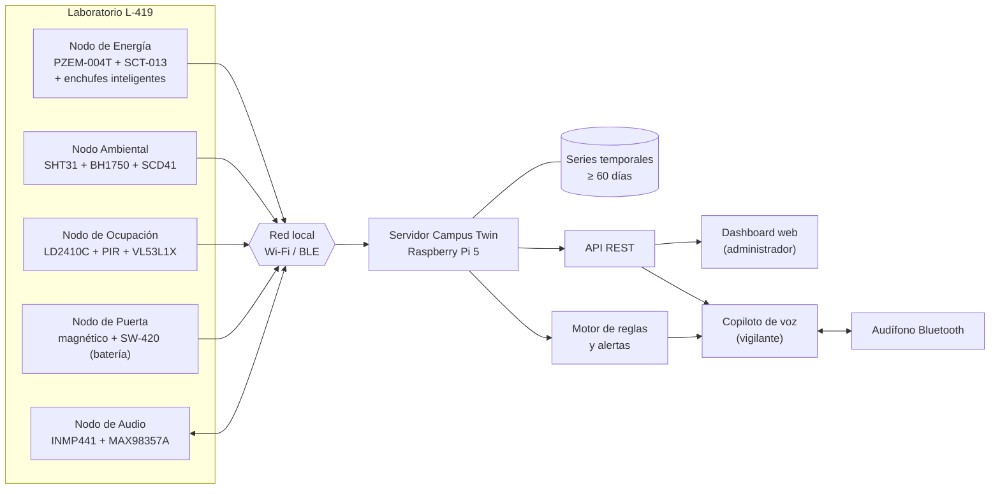

# Idea principal — Campus Twin L-419

> Documento maestro del proyecto: consolida y completa
> [01-preformulacion.md](01-preformulacion.md) e [02-instrumentacion-l419.md](02-instrumentacion-l419.md).
> Los identificadores de requisito (NS, RF, RNF, CP) son los mismos en este documento, en el
> modelo SysML de [modelo/](../modelo/) y en las tareas de Asana.
> Última actualización: **03/09/2026** (semana 4 del ciclo).

## 1. Resumen ejecutivo

Campus Twin es el **gemelo digital de un espacio de enseñanza de UTEC**: el aula laboratorio
**L-419**. Un conjunto de nodos ESP32 mide energía, ambiente, ocupación y eventos de puerta, y
envía los datos por Wi-Fi/BLE a una Raspberry Pi 5 que actúa de servidor. Sobre esos datos
corren dos interfaces humano-computador: un **dashboard web** para el administrador de
infraestructura y un **copiloto de voz** para el vigilante nocturno, que recibe un briefing al
iniciar su ronda y puede consultar el estado del laboratorio hablando.

El diferenciador del proyecto no es medir: es **cruzar las mediciones**. Con energía,
iluminancia y ocupación en la misma serie temporal, el sistema puede responder algo que hoy
nadie en el campus puede responder con evidencia: *cuánta energía se gasta en un laboratorio
vacío*. Ese es el reporte de **consumo fantasma** (RF-10), y es la base del caso de ahorro.

## 2. Necesidad, problema, causas y solución

| | |
|---|---|
| **Necesidad.** La universidad necesita operar sus espacios de enseñanza con evidencia: saber cuánta energía consumen, en qué condiciones ambientales se dictan las clases y qué pasa en ellos cuando están cerrados. | **Problema.** Hoy el laboratorio L-419 es una caja negra: el consumo solo se conoce agregado en la factura del edificio, el confort se reporta por queja y la vigilancia nocturna depende de lo que el vigilante alcanza a ver en su ronda. |
| **Causas.** (1) No hay instrumentación por espacio, solo medición general del edificio. (2) Instalar medición suele exigir intervenir el tablero eléctrico, lo que requiere permisos y paradas. (3) La información existente no llega a quien decide en el momento en que decide: el vigilante no tiene pantalla y el administrador no tiene datos por ambiente. | **Solución.** Un gemelo digital del laboratorio con instrumentación no invasiva, servidor local y dos interfaces: dashboard web para análisis y copiloto de voz para operación en campo. El propio laboratorio es el banco de pruebas y la evidencia. |

## 3. Stakeholders

| Stakeholder | Qué le importa | Qué obtiene del sistema | Cómo participa |
|---|---|---|---|
| **Vigilante nocturno** | Hacer la ronda rápido, sin cargar equipo, y no perderse un incidente | Briefing de turno por voz y consultas orales (RF-09), alertas de puerta (RF-04, RF-08) | Entrevista de necesidades (S5) y prueba de uso del copiloto (S12) |
| **Administrador de infraestructura / Servicios Generales** | Reducir consumo y sustentarlo con datos (LEED/EDGE) | Dashboard con consumo, históricos y reporte de consumo fantasma (RF-01, RF-06, RF-07, RF-10) | Autoriza la instalación y valida el reporte de ahorro |
| **Coordinador del laboratorio / docentes** | Que el ambiente sea apto para clase y equipos | CO₂, temperatura, humedad e iluminancia en vivo (RF-02) y alertas de confort (RF-08) | Define horarios de acceso e interpreta umbrales |
| **Seguridad del campus** | Detectar accesos y manipulaciones fuera de horario | Eventos de puerta y vibración con alerta (RF-04) | Define el horario y el protocolo de alerta |
| **Estudiantes del laboratorio** | Privacidad | Sin cámaras ni audio almacenado; ocupación agregada (RNF-02) | Restricción de diseño, no negociable |
| **Equipo PI3 y docente del curso** | Demo en vivo y entregables a tiempo | Modo demostración (RF-11) y sistema estable 72 h (RNF-06) | Ejecuta el proyecto; el docente evalúa |
| **Red / TI de UTEC** | No abrir huecos en la red del campus | Red local propia para los nodos (RNF-05) | Autoriza o no el uso de la red institucional |

## 4. Alcance: el laboratorio L-419 como piloto

El piloto es un **laboratorio**, no un aula común, y eso cambia tres cosas a favor:

| Condición del laboratorio | Qué habilita |
|---|---|
| **Acceso a energía** (tomacorrientes disponibles en varios puntos) | Los nodos fijos van alimentados con fuente de 5 V, sin depender de batería: se puede medir de forma continua, de noche y por días seguidos (RNF-06). La batería queda solo para el nodo de puerta (RNF-04). |
| **Wi-Fi disponible** | Los nodos transmiten sin cablear datos. Si TI no autoriza los dispositivos en la red institucional, se levanta un router propio y el sistema sigue funcionando igual (RNF-05). |
| **Espacio amplio** | Se puede separar el radar de ocupación del sensor de puerta y cubrir la sala con 2 nodos de ocupación sin solaparse; también hay sitio para el banco de pruebas y para instalar sin estorbar la clase. |
| **Equipos propios del laboratorio** (PCs, proyector, instrumentos) | Hay cargas medibles e identificables por enchufe inteligente, que es lo que hace interesante el reporte de consumo fantasma. |

**Dentro del alcance:** un espacio (L-419), cuatro tipos de nodo, servidor local, dashboard web
en LAN, copiloto de voz en español, reporte de consumo fantasma y ahorro estimado.

**Fuera del alcance (declarado):** control de actuadores (el sistema informa, no apaga cargas);
gemelo 3D fotorrealista (se usa un plano 2D del laboratorio); escalamiento a todo el campus
(se documenta cómo replicar, no se replica); reconocimiento de personas o cámaras.

## 5. ODS

| ODS | Cómo lo aborda el proyecto |
|---|---|
| **7 — Energía asequible y no contaminante** | Mide y reduce consumo evitable; el reporte de consumo fantasma cuantifica el desperdicio. |
| **11 — Ciudades y comunidades sostenibles** | Instrumenta infraestructura educativa existente sin obra civil, con un método replicable a otros ambientes. |
| **13 — Acción por el clima** | Traduce kWh evitados a emisiones evitadas con el factor de la red peruana. |
| **4 — Educación de calidad** (secundario) | Condiciones ambientales aptas para el dictado y un laboratorio que sirve de caso de estudio. |
| **9 — Innovación e infraestructura** (secundario) | Gemelo digital de bajo costo con hardware abierto, documentado para reproducirse. |

## 6. Arquitectura de la solución

**Cadena de datos:** sensores → ESP32 → Wi-Fi/BLE → Raspberry Pi 5 (broker + base de datos) →
LAN → dashboard web y copiloto de voz. Ningún sensor lleva cable de datos hasta la computadora
y la instalación no perfora paredes ni interviene el tablero (RNF-01).

| Subsistema | Responsabilidad | Bloque en el modelo SysML |
|---|---|---|
| Subsistema de Sensado | Adquirir y publicar mediciones | `Nodo Sensor ESP32` y sus especializaciones |
| Servidor Campus Twin | Recibir, almacenar, servir y evaluar reglas | `Servidor Campus Twin` (broker MQTT, TSDB, API REST, motor de reglas, servicio de voz) |
| Dashboard Web | Visualización y reportes | `Dashboard Web` |
| Copiloto de Voz | Briefing y consultas orales | `Copiloto de Voz` (nodo de audio + audífono BT) |
| Red Local | Transporte, aislada de la red del campus si hace falta | `Red Local` |
| Subsistema de Alimentación | Energía de nodos y servidor | `Subsistema de Alimentación` |

## 7. Casos de uso principales

1. **Briefing de ronda (vigilante, 22:00).** Al iniciar la ronda pregunta *"¿cómo está el
   L-419?"* y el copiloto responde: estado de puerta, ocupación, consumo actual y si hay algo
   anómalo desde el turno anterior. → RF-09, RF-08.
2. **Consumo fantasma (administrador, cierre de mes).** El dashboard reporta cuántos kWh se
   consumieron con el laboratorio desocupado, desglosados por franja horaria, y estima el
   ahorro de corregirlo. → RF-10, RF-07, RF-01, RF-03.
3. **Confort en clase (coordinador, media mañana).** El CO₂ pasa el umbral con el laboratorio
   lleno; el dashboard alerta y queda registrado para justificar ventilación. → RF-02, RF-08.
4. **Apertura fuera de horario (seguridad, 03:00).** El sensor magnético detecta apertura sin
   ocupación programada: se registra el evento y el copiloto lo anuncia en la siguiente
   consulta del vigilante. → RF-04, RF-08.

## 8. Requisitos

### 8.1 Necesidades de stakeholder (NS)

| ID | Necesidad | Enunciado |
|---|---|---|
| NS-1 | Ronda informada | El vigilante nocturno necesita conocer el estado del laboratorio durante su ronda sin cargar una laptop. |
| NS-2 | Consumo bajo control | El administrador de infraestructura necesita evidencia medible del consumo para reducirlo y sustentar certificaciones. |
| NS-3 | Ambiente apto | El coordinador del laboratorio necesita temperatura, humedad y CO₂ aptos para las clases y los equipos. |
| NS-4 | Acceso vigilado | Seguridad del campus necesita detectar aperturas o manipulaciones del laboratorio fuera de horario. |
| NS-5 | Demostración reproducible | El equipo de PI3 necesita una demo en vivo que funcione sin depender de la red del campus. |

### 8.2 Requisitos funcionales (RF)

| ID | Requisito | Criterio de aceptación | Deriva de | Bloque que lo satisface | Se verifica con |
|---|---|---|---|---|---|
| RF-01 | Medición de energía | Tensión, corriente, potencia y energía acumulada con periodo ≤ 10 s y error ≤ ±2 % frente a instrumento patrón | NS-2 | Nodo de Energía | CP-01 |
| RF-02 | Medición ambiental | Temperatura, humedad, CO₂ e iluminancia con periodo ≤ 60 s | NS-3 | Nodo Ambiental | CP-07 |
| RF-03 | Estimación de ocupación | Presencia y conteo sin cámaras, latencia ≤ 30 s, error ≤ ±1 persona con hasta 10 personas | NS-1, NS-3 | Nodo de Ocupación | CP-02 |
| RF-04 | Eventos de puerta | Apertura y vibración registradas en ≤ 10 s | NS-4 | Nodo de Puerta | CP-08 |
| RF-05 | Transporte de datos | Envío por Wi-Fi/BLE con reintento y buffer local ≥ 15 min ante caída del servidor | NS-5 | Red Local | CP-03 |
| RF-06 | Histórico y consulta | Series temporales ≥ 60 días y API de consulta por rango y magnitud | NS-2 | Base de Datos de Series Temporales | CP-09 |
| RF-07 | Dashboard web | Estado en vivo con refresco ≤ 5 s, históricos y reporte de ahorro, accesible en la LAN | NS-2 | Dashboard Web | CP-09 |
| RF-08 | Alertas por reglas | Reglas configurables de consumo, CO₂ y puerta fuera de horario, notificadas en dashboard y voz | NS-1, NS-4 | Motor de Reglas y Alertas | CP-10 |
| RF-09 | Copiloto de voz | Briefing de turno automático y respuesta a consultas orales en español en ≤ 5 s | NS-1 | Copiloto de Voz | CP-04 |
| RF-10 | Detección de consumo fantasma | Reporte de energía consumida con el laboratorio desocupado, cruzando energía, iluminancia y ocupación | NS-2 | Motor de Reglas y Alertas | CP-06 |
| RF-11 | Modo demostración | Reproducción de un día de datos grabados para sostener la demo si falla el hardware | NS-5 | Servidor Campus Twin | CP-11 |

### 8.3 Requisitos no funcionales y restricciones (RNF)

| ID | Restricción | Criterio de aceptación | Deriva de | Se verifica con |
|---|---|---|---|---|
| RNF-01 | Instalación no invasiva | Sin perforar paredes ni intervenir el tablero: montaje adhesivo y pinza no invasiva | NS-5 | CP-12 |
| RNF-02 | Privacidad por diseño | Sin cámaras; audio no almacenado; ocupación reportada de forma agregada | NS-4 | CP-12 |
| RNF-03 | Presupuesto acotado | ≤ S/ 2713 en la versión completa; versión mínima operativa de S/ 653 | NS-5 | CP-14 |
| RNF-04 | Autonomía de nodos | Nodo de puerta ≥ 30 días con una carga | NS-4 | CP-13 |
| RNF-05 | Red autónoma | El sistema opera completo sobre router propio si TI no autoriza la red del campus | NS-5 | CP-03 |
| RNF-06 | Disponibilidad para la demo | 72 h continuas sin intervención manual antes de la presentación | NS-5 | CP-05 |
| RNF-07 | Configurabilidad | Pines, umbrales, intervalos y endpoints en configuración; sin credenciales en el repositorio | NS-5 | CP-14 |

### 8.4 Casos de prueba (CP)

| ID | Ensayo | Verifica |
|---|---|---|
| CP-01 | Exactitud de energía contra multímetro y carga conocida | RF-01 |
| CP-02 | Ocupación con personas quietas y conteo en la puerta | RF-03 |
| CP-03 | Resiliencia de red: 15 min sin servidor y caída del router | RF-05, RNF-05 |
| CP-04 | Copiloto de voz: 20 consultas, latencia y aciertos | RF-09 |
| CP-05 | Maratón de 72 horas sin intervención | RNF-06 |
| CP-06 | Auditoría de consumo fantasma en una semana de datos | RF-10 |
| CP-07 | Calibración ambiental contra instrumento patrón | RF-02 |
| CP-08 | Eventos de puerta: apertura, golpe y falso positivo | RF-04 |
| CP-09 | Histórico, API y dashboard: consultas por rango y refresco | RF-06, RF-07 |
| CP-10 | Reglas de alerta: disparo, silencio y umbral configurable | RF-08 |
| CP-11 | Modo demostración con hardware desconectado | RF-11 |
| CP-12 | Revisión de instalación no invasiva y privacidad | RNF-01, RNF-02 |
| CP-13 | Autonomía del nodo de puerta | RNF-04 |
| CP-14 | Auditoría de costos y de configuración del repositorio | RNF-03, RNF-07 |

## 9. Métricas de éxito

| Métrica | Meta al cierre (semana 14) |
|---|---|
| Cobertura de requisitos | 100 % de RF y RNF con bloque que los satisface y caso de prueba ejecutado |
| Exactitud de energía | Error ≤ ±2 % frente a instrumento patrón |
| Disponibilidad | ≥ 72 h continuas sin intervención (RNF-06) |
| Datos perdidos | ≤ 1 % de muestras perdidas en una semana |
| Consumo fantasma identificado | ≥ 5 % del consumo semanal del laboratorio cuantificado como evitable |
| Copiloto de voz | ≥ 80 % de respuestas correctas en 20 consultas, latencia ≤ 5 s |
| Costo | ≤ S/ 2713 ejecutado |

## 10. Instrumentación y presupuesto

El detalle por ítem (tienda, enlace, SKU, cantidad y precio) está en
[02-instrumentacion-l419.md](02-instrumentacion-l419.md). Resumen:

| Módulo | S/ | Nota |
|---|---|---|
| Procesadores | 833 | 4 ESP32 DevKit + Raspberry Pi 5 y accesorios |
| Energía | 305 | PZEM-004T + SCT-013 + 2 enchufes inteligentes |
| Ambiente | 286 | SCD41, SHT31, BH1750 |
| Ocupación | 266 | LD2410C, PIR, VL53L1X |
| Puerta y seguridad | 36 | Magnético + SW-420 |
| Copiloto de voz | 188 | INMP441, MAX98357A, parlante, audífono BT |
| Integración | 799 | Router, fuentes, cajas, cables, multímetro |
| **Total** | **2713** | Versión mínima: **653** (sin Pi, usando laptop del equipo) |

Como el laboratorio tiene tomacorrientes, la versión completa se instala alimentada de red y
**no** se aplica la limitación de la versión mínima ("no se pueden tomar datos de noche ni
durante días seguidos"): la medición continua es justamente lo que sostiene RF-10 y RNF-06.

## 11. Riesgos y mitigaciones

| Riesgo | Impacto | Mitigación |
|---|---|---|
| No autorizan intervenir el tablero para el PZEM-004T | Alto: sin medición total del laboratorio | Enchufes inteligentes por carga + pinza SCT-013 en el alimentador accesible; el requisito RF-01 se cumple por suma de cargas |
| TI no autoriza los ESP32 en la red del campus | Alto: sin transporte de datos | Router propio ya presupuestado (RNF-05), verificado en CP-03 |
| Retraso en compras o stock agotado | Medio: corre el cronograma | Compra en semana 6 con proveedor alterno identificado; versión mínima (S/ 653) como plan B |
| Radar de ocupación con falsos positivos | Medio: ocupación poco creíble | Fusión de radar + PIR + conteo ToF y validación cruzada con CO₂; calibración en CP-02 |
| Latencia o error del copiloto de voz | Medio: la demo pierde efecto | Intenciones cerradas y respuestas plantilladas sobre la API; CP-04 mide latencia y aciertos |
| Falla de hardware el día de la presentación | Alto: no hay demo | Modo demostración con datos grabados (RF-11, CP-11) |
| Pérdida de datos por corte de energía | Medio | Buffer local en el nodo (RF-05) y escritura periódica en la Pi |
| Sobrecarga académica del equipo en semanas 10-13 | Medio | Tareas de una semana como máximo, un responsable por tarea y revisión semanal en Asana |

## 12. Plan de trabajo (semanas 4 a 14)

Semana 4 = 31/08–06/09/2026. Entrega final: **viernes 13/11/2026** (semana 14).

| Semana | Fechas | Foco | Responsable principal |
|---|---|---|---|
| S4 | 31/08–06/09 | Formulación, modelo SysML (req + bdd), proyecto en Asana | Luhana / José |
| S5 | 07/09–13/09 | Entrevistas a stakeholders, permisos de instalación y de red, cierre de cotización | Luhana |
| S6 | 14/09–20/09 | Compra y recepción de componentes, banco de pruebas, contrato de datos (tópicos MQTT y esquema) | Carlos / José |
| S7 | 21/09–27/09 | Firmware base ESP32 (Wi-Fi, reconexión, buffer) y servidor Pi (broker + base de series temporales) | Carlos / José |
| S8 | 28/09–04/10 | Nodo de energía y nodo ambiental integrados y calibrados (CP-01, CP-07) | Carlos / Luhana |
| S9 | 05/10–11/10 | Nodo de ocupación y nodo de puerta (CP-02, CP-08) | Esteban |
| S10 | 12/10–18/10 | API REST, motor de reglas y detección de consumo fantasma (CP-09, CP-10) | José |
| S11 | 19/10–25/10 | Dashboard web con vivo, históricos y reporte de ahorro | José |
| S12 | 26/10–01/11 | Copiloto de voz: briefing y consultas (CP-04) | Esteban |
| S13 | 02/11–08/11 | Pruebas de sistema: maratón 72 h, consumo fantasma, modo demo, revisiones (CP-05, CP-06, CP-11, CP-12, CP-13, CP-14) | Luhana / todos |
| S14 | 09/11–15/11 | Informe final, póster, ensayo y **presentación (13/11)** | Todos |

Reparto por subsistema:

| Integrante | Responsabilidad |
|---|---|
| **José Eduardo Huamán** | Líder técnico: servidor Raspberry Pi, broker, base de datos, API REST, dashboard web, integración |
| **Carlos Dávila** | Firmware ESP32, nodo de energía, red local y alimentación |
| **Esteban Sotomayor** | Nodo de ocupación, nodo de puerta y copiloto de voz |
| **Luhana Landeo** | Modelo SysML y documentación, stakeholders y permisos, compras, nodo ambiental, plan y ejecución de pruebas |

## 13. Entregables

1. **Documentación** en `docs/`: idea principal (este documento), pre-formulación e instrumentación costeada.
2. **Modelo SysML** en `modelo/campus-twin-l419.gaphor`: 12 diagramas — 7 de requisitos y 5 de definición de bloques, incluido el paquete `00 Vista general` con el sistema completo y el mapa de requisitos, cada uno en un solo diagrama. Exportados en `modelo/export/`.
3. **Plan en Asana**: fases S4–S14 con tareas, responsables, fechas e hitos.
4. **Firmware** de los nodos ESP32, **servidor** (broker, base de datos, API, reglas) y **dashboard web**, cada uno con su README.
5. **Copiloto de voz** con briefing y consultas en español.
6. **Informe de resultados**: mediciones, cobertura de casos de prueba y ahorro estimado.
7. **Demo en vivo** el 13/11/2026, con modo demostración como respaldo.

## 14. Mejoras respecto a la pre-formulación

Lo que este documento agrega o cambia frente a [01-preformulacion.md](01-preformulacion.md):

1. **Piloto en un laboratorio con energía, Wi-Fi y espacio**, no en un aula genérica. Eso
   permite medición continua alimentada de red, y con ello RF-10 y RNF-06, que antes no eran
   viables con la versión mínima a batería.
2. **Un diferenciador medible: consumo fantasma (RF-10).** La propuesta original prometía
   "reportes de ahorro"; aquí el ahorro se define como una cuenta concreta y verificable
   (energía consumida con el espacio desocupado) con su propio caso de prueba.
3. **Requisitos con criterio de aceptación numérico** (periodos, latencias, errores, días de
   retención) y trazabilidad cerrada NS → RF/RNF → bloque → caso de prueba, que es lo que el
   modelo SysML refleja.
4. **Stakeholders completos** —la pre-formulación los dejaba pendientes— con qué obtiene cada
   uno y cómo participa.
5. **Privacidad como restricción de diseño (RNF-02)**: sin cámaras, sin audio almacenado y
   ocupación agregada. Se vuelve un argumento del proyecto, no un descargo.
6. **Modo demostración (RF-11)**: la demo no depende de que el hardware coopere ese día.
7. **Red propia como requisito (RNF-05)**, no como accesorio del BOM: el proyecto no queda
   bloqueado por una decisión de TI.
8. **Plan por semanas del ciclo (S4–S14) con un responsable por tarea**, alineado 1 a 1 con el
   tablero de Asana.
9. **Alcance negativo explícito**: sin control de actuadores, sin gemelo 3D fotorrealista, sin
   escalar al campus. Evita discusiones de alcance a mitad de ciclo.

## 15. Preguntas pendientes para el stakeholder

Para la entrevista de la semana 5:

1. ¿Se autoriza instalar la pinza SCT-013 en el alimentador del laboratorio, o se trabaja solo con enchufes inteligentes por carga?
2. ¿Cuál es el horario oficial de uso del L-419? Se necesita para definir "fuera de horario" en RF-04 y RF-08.
3. ¿Qué umbral de CO₂ usa la universidad como aceptable? (referencia inicial: 1000 ppm)
4. ¿Puede TI autorizar los nodos en la red del campus o se trabaja con router propio (RNF-05)?
5. ¿Existe la factura eléctrica o medición previa del edificio para construir la línea base de ahorro?
6. ¿Quién recibe las alertas fuera de horario y por qué canal, además del copiloto de voz?
7. ¿Hay restricción para dejar equipos instalados durante la noche y los fines de semana?
8. ¿El plano del laboratorio está disponible para el dashboard 2D?

## 16. Dónde vive cada cosa

| Qué | Dónde |
|---|---|
| Idea, requisitos y plan | este documento |
| Pre-formulación original | [01-preformulacion.md](01-preformulacion.md) |
| Instrumentación y costos | [02-instrumentacion-l419.md](02-instrumentacion-l419.md) y [data/instrumentacion-l419.csv](data/instrumentacion-l419.csv) |
| Modelo SysML (req y bdd) | [../modelo/campus-twin-l419.gaphor](../modelo/campus-twin-l419.gaphor) y [../modelo/README.md](../modelo/README.md) |
| Diagramas exportados | [../modelo/export/](../modelo/export/) |
| Tareas, responsables y fechas | Proyecto [PI3 — Campus Twin L-419](https://app.asana.com/1/1218151758126339/project/1218156351516043) en Asana |
| Avance de las tareas (espejo local) | [03-plan.md](03-plan.md) |
