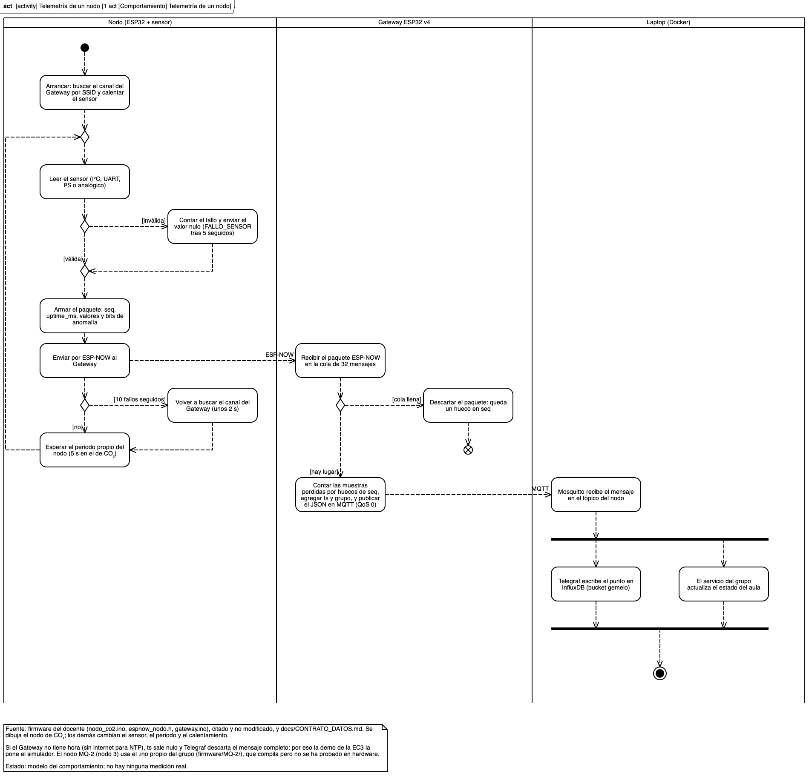
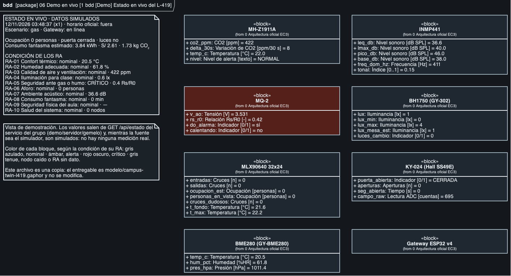

<!--
Sección del reporte de la EC3: el gemelo en Gaphor. Va después de «Auditoría del consumo fantasma» y de
las capturas de Grafana (figuras 15 y 16) y antes de Asana. Sus figuras son las 17 a 24, así que las
de Asana pasan a ser la 25 y la 26. Las rutas son relativas a este archivo. Estado: 12/11/2026.
-->

# Gemelo en Gaphor (modelo SysML)

El gemelo digital del L-419 se modela en [Gaphor](https://gaphor.org) con SysML. El archivo
`modelo/campus-twin-l419.gaphor` es el entregable y `modelo/tools/build_model.py` lo regenera por
completo, de modo que cada elemento se puede rastrear hasta el documento maestro, la configuración
o el código del docente. Para la EC3 el modelo pasó de 12 diagramas en 4 paquetes (Semana 7) a
**36 diagramas en 6 paquetes**, y dejó de describir la propuesta original (Raspberry Pi, PZEM, SHT31)
para describir la arquitectura oficial del curso.

| Paquete | Semana 7 | EC3 | Qué cambió |
|---|---|---|---|
| 00 Vista general | 2 | 2 | Se conservan; el mapa de requisitos usa los textos del 10/11 |
| 01 Requisitos | 4 | 6 | Se agregan los RA-01..10 con su derivación y su trazabilidad a la arquitectura oficial |
| 02 Estructura | 4 | 9 | Se conservan los 4 de septiembre y se agrega el subpaquete «Arquitectura oficial EC3»: 4 bdd y 1 ibd |
| 03 Verificación | 2 | 3 | Casos de prueba actualizados, sin CP-01 (retirado el 10/11) y con los de los RA |
| 04 Comportamiento | — | 6 | Nuevo: 3 actividades, 2 máquinas de estados y 1 de casos de uso |
| 05 Diagnóstico causal | — | 10 | Nuevo: un diagrama por RA, enlazado a la figura de su grafo |

## Estructura: la arquitectura oficial

El bdd del sistema muestra los siete nodos, el Gateway ESP32 v4, la red Wi-Fi local, la laptop con
Docker y el aula que se monitorea. Cada caja de nodo hereda de una caja abstracta el ESP32 DevKit
V1, la protoboard de 170 puntos, la batería 18650 con su porta-batería y el regulador (pendiente de
definir), y agrega su sensor. **Cada sensor declara los campos que entrega en el JSON del Gateway**
(`co2_ppm`, `leq_db`, `rs_r0`...) y referencia la foto de su etiqueta con QR de la orden de compra;
el MQ-2 y el MLX90640 no tienen foto, y el modelo lo dice.

El diagrama interno de bloques (IBD) sigue el dato de punta a punta: sensor → ESP32 (UART, I²S,
I²C o analógico) → ESP-NOW → Gateway → Wi-Fi/MQTT → Mosquitto → Telegraf → InfluxDB → servicio
del grupo, tablero, Gaphor en vivo y copiloto. Cada conector lleva el medio por el que viaja y un
flujo de item con su sentido (24 flujos). Incluye el simulador, que hoy es la única fuente de datos.

## Requisitos y trazabilidad

El modelo tiene las 7 necesidades (NS), los 13 requisitos funcionales y los 12 no funcionales con el
texto del documento maestro (el del 10/11 y, desde el 12/11, los de las cajas), y los **diez requisitos de alto nivel RA-01..10** leídos de
`config/requisitos_ra.yaml`, el mismo archivo que usa el servicio. La regla que el script comprueba
al regenerar es que **todo RF y todo RA tienen un bloque que los satisface (`satisfy`) y un caso de
prueba que los verifica (`verify`)**, y que todo RNF tiene caso de prueba. Hoy no queda ninguno sin
cubrir. Los requisitos de las cajas (RNF-09..12: montaje, operación, dimensiones y energía) derivan de
NS-5, los satisface el bloque «Caja de nodo» y los verifican CP-16 (inspección, para RNF-09, 10 y 11) y
CP-13 (autonomía, para RNF-12); ambos ensayos están **pendientes** de la semana 15. El `satisfy` apunta a los bloques de la arquitectura oficial: los nodos que miden cada RA y
el evaluador de RA, que satisface los diez.

El paquete **05 Diagnóstico causal** tiene un diagrama por RA con su texto completo y una nota con
su grafo (título, causas raíz, efectos) y la ruta de su figura en `grafos/figuras/`. Las figuras se
enlazan por ruta y no se incrustan: pesarían unos 2 MB en el `.gaphor` y quedarían desactualizadas
cada vez que se regeneran los grafos.

## Comportamiento

Los seis diagramas del paquete 04 salen del firmware del docente, del servicio del grupo y del brief
de la EC3, y cada uno cita su fuente en una nota.

- **Actividades.** *Telemetría de un nodo* (del arranque al estado del aula, en tres carriles: nodo,
  Gateway y laptop, con la nueva búsqueda de canal tras 10 envíos fallidos y la cola de 32 mensajes
  del Gateway); *entrada y salida de personas* (la rama del KY-024 y la de la MLX90640 corren en
  paralelo y las junta el servicio); *detección, diagnóstico y alerta* (evaluación de RA-01..10,
  recorrido del grafo SymCure y avisos por bitácora, MQTT, tablero y voz).
- **Máquinas de estados.** *Aula*: Vacío, Ocupado, Sobreaforo, Luces sin ocupación (RA-08), Uso
  fuera de horario (RA-09) y Alarma de gas (RA-05), que manda sobre todos los demás. *Nodo*:
  Calentando, Activo, Falla del sensor y Sin datos (decidido por el servicio tras tres periodos sin
  paquete).
- **Casos de uso.** Clase, mantenimiento, limpieza, emergencia, monitoreo del administrador y ronda
  del vigilante, con los casos que varios comparten (condición de los RA, diagnóstico causal, salud de
  nodos, registro de eventos, consumo fantasma y consulta por voz).

Modelar el comportamiento obligó a leer el código con cuidado y dejó cuatro hallazgos. Dos ya se
corrigieron el 12/11: el servicio ahora silencia la repetición de una alerta (RF-08) y el documento
maestro dice que los nodos vuelven a buscar el canal tras 10 envíos fallidos, no solo al arrancar.
Quedan dos, anotadas en `modelo/README.md`: el nodo térmico cuenta sin mirar al KY-024 (los junta el
servicio, así que la «coordinación» de RF-03 es del servicio) y el tópico `diagnostico` de la decisión
D4 no se publica todavía, porque las causas y recomendaciones viajan dentro del evento.

## Gaphor en vivo

`demo/gaphor-vivo/` abre una copia del modelo, consulta `http://localhost:8000/api/estado` cada
segundo y hace dos cosas. **Escribe en el bloque de cada uno de los 7 sensores los campos que su nodo
reportó** (37 valores por consulta, por ejemplo `co2_ppm = 422` en el MH-Z1911A). **Pinta cada bloque
según la condición de su RA**: gris azulado si es nominal, ámbar en alerta, rojo oscuro en crítico y
gris tenue si el nodo está caído o su RA no se puede evaluar. Si un nodo participa en varios RA,
toma el color del peor. La nota del diagrama rotula la fuente: mientras sea el simulador dice
**DATOS SIMULADOS**. El código usa solo la biblioteca estándar, porque corre en el intérprete de
Gaphor, y no modifica el entregable: trabaja siempre sobre una copia.

**Verificación.** 21 pruebas automáticas (parte de las 111 del servicio) comparan la tabla de nodos y
RA del enlace con `config/nodos.yaml`, `config/requisitos_ra.yaml` y los bloques de `build_model.py`, y
comprueban los colores y el formato de cada campo. Además se corrió el enlace contra el simulador: con
el escenario `gas` se pintaron de rojo el MQ-2 y la caja del nodo 3, y con `nodo-sin-bateria` quedaron
en gris el nodo 5 y el nodo 4, cuyos RA no se pueden evaluar sin el 5.

## Estado al 12/11/2026

| Parte | Estado |
|---|---|
| Diagramas del modelo (36) y su exportación en SVG y PNG | Hecho; se regeneran con `build_model.py` |
| Arquitectura oficial, IBD, RA, trazabilidad y comportamiento | Hecho: modelo basado en la documentación y el código; **ningún dato es una medición real** |
| Enlace en vivo con 7 sensores y color por RA | Hecho y probado con el simulador (**simulado**); sin probar con el Gateway real |
| Requisitos de las cajas RNF-09..12 y caso de prueba CP-16 | Hecho en el modelo (derivación, `satisfy` y `verify`); su ensayo físico está **pendiente** (S15) |
| Comportamiento con hardware (conteo, puerta, autonomía) | **Pendiente** de las pruebas de la semana 15 |

**Reproducir.** `gaphor exec modelo/tools/build_model.py` regenera el modelo (necesita el entorno
virtual del servicio para leer los RA); `gaphor export -f svg -u -o modelo/export modelo/campus-twin-l419.gaphor`
exporta los diagramas, y `demo/gaphor-vivo/lanzar.sh` abre el modelo en vivo. El firmware de los nodos,
el Gateway y el stack del servidor son del docente y se citan, no se modifican; el modelo, el script
que lo genera, los diagramas de comportamiento y el enlace en vivo son del grupo.
